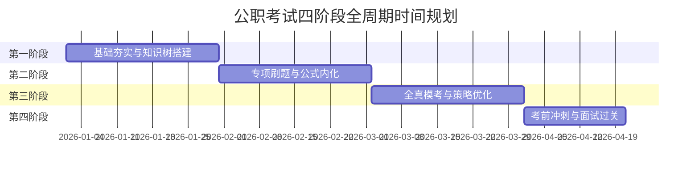

# 公务员与事业单位编制考试备考总览

欢迎进入体制内公职考试（国家公务员、地方省考、事业单位联考/统考、选调生、三支一扶）全流程通关指南。

---

## 1. 考种与科目体系对比

| 考种分类 | 笔试科目 | 重点考查方向 |
| :--- | :--- | :--- |
| **国家公务员考试 (国考)** | 行测（地市/副省/行政执法） + 申论 | 政治素养极高、材料阅读量大、行测题量大（130~135题） |
| **各省公务员考试 (省考)** | 行测 + 申论 | 贴合地方政策经济、联考命题规范度高 |
| **事业单位联考 (全国统考)** | 职业能力倾向测验 (职测) + 综合应用能力 | 区分 A/B/C/D/E 类（综合管理/社会科学/自然科学/中小学教师/医疗卫生） |
| **事业单位单招 / 统考** | 公共基础知识 (公基) + 申论 / 专业科目 | 法律、政治理论、公文写作、常识与时政 |

---

## 2. 四阶段全周期学习计划表

### 第一阶段：基础夯实与体系搭建（第 1~4 周）

- **核心目标**：全面通学行测五大模块（言语、判断、资料、数量、常识）与申论五大题型底层逻辑，消灭所有考点盲区。
- **重点产出**：
  - 资料分析：背熟分数与百分数互化表，掌握现期、基期、增长量、增长率、比重、平均数公式。
  - 判断推理：熟记图形推理位置/样式/属性/数量规律；掌握翻译推理和削弱加强逻辑公式。
  - 申论：掌握审题要素（题型、作答对象、材料范围、字数、特殊要求），掌握“找点 $\rightarrow$ 分类 $\rightarrow$ 提炼”三步法。

### 第二阶段：专项刷题与技巧秒杀（第 5~8 周）

- **核心目标**：分模块专项突破，题量累计达标，形成题目肌肉记忆。
- **训练指标**：
  - **资料分析**：每日 4 篇（20题），限时 25 分钟，准确率稳定在 $85\%$ 以上。
  - **申论小题**：每日 2 题，提炼前置总括词，严格比对官方采分点。
  - **大作文积累**：每周精读 2 篇官媒社论（人民日报/求是），梳理分论点论证语料。

### 第三阶段：全真模考与考场策略（第 9~12 周）

- **上午 09:00 - 11:00（行测/职测）**：全真计时模考，推荐顺序：常识 $\rightarrow$ 言语 $\rightarrow$ 判断 $\rightarrow$ 资料 $\rightarrow$ 数量挑做，留 5-10 分钟涂卡。
- **下午 14:00 - 17:00（申论/综应）**：全真答题纸手写，严格把控卷面工整度与格子字数。

### 第四阶段：考前冲刺与面试通关（考前 2 周至面试）

- **笔试冲刺**：复盘错题集，集中背诵近 1 年重大国家时政会议与科技成就。
- **面试进阶**：掌握综合分析、应急应变、人际沟通、组织策划四题型破解结构，每日开口实训。

---

## 3. 每日作息与时间规划

| 时间段 | 学习任务 | 目标要求 |
| :--- | :--- | :--- |
| **08:00 - 09:00** | 晨读时政与社论 | 背诵时政热点，摘抄申论政论规范词 |
| **09:00 - 12:00** | 行测/职测专项突破 | 严格限时刷题与错题深度复盘 |
| **14:00 - 17:30** | 申论/公基书写训练 | 落实答题纸手写，逐字对比标准采分点 |
| **19:00 - 21:30** | 薄弱考点攻坚 | 专题错题归因，整理秒杀速记口诀 |
| **21:30 - 22:30** | 面试框架复述 | 每日开口练题，训练脱稿流畅度 |
