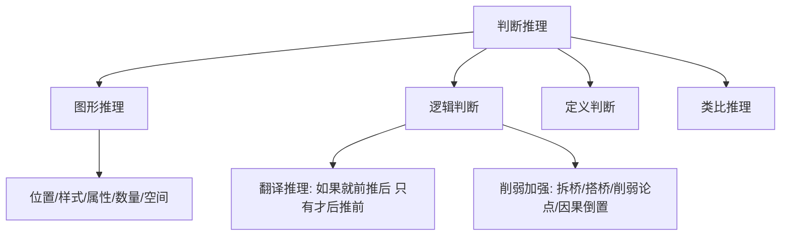

# 行测与职测高分速战指南

行政职业能力测验（行测）与职业能力倾向测验（职测）考查的核心不是“难题攻坚”，而是“在有限时间内拿最高分”。

---

## 1. 资料分析（保准保快提分利器）

资料分析是行测中最容易拿满分的模块。必须做到：**公式秒反应、计算少动笔、数据巧截位**。

### 核心计算公式汇总

1. **基期与现期**：
   $$\text{基期量} = \frac{\text{现期量}}{1 + r} \approx \text{现期量} \times (1 - r) \quad (|r| \le 5\%)$$
2. **增长量与增长率**：
   $$\text{增长量} = \text{现期量} - \text{基期量} = \frac{\text{现期量} \times r}{1 + r}$$
   *技巧：当 $r \approx \frac{1}{n}$ 时，增长量 $\approx \frac{\text{现期量}}{n + 1}$；减少量 $\approx \frac{\text{现期量}}{n - 1}$。*
3. **两期比重差值**：
   $$\text{现期比重} - \text{基期比重} = \frac{A}{B} \times \frac{a - b}{1 + a}$$
   - 部分增速 $a >$ 整体增速 $b \implies$ 比重上升。
   - 部分增速 $a <$ 整体增速 $b \implies$ 比重下降。
   - 比重差值的绝对值必 $< |a - b|$。

### 截位直除速算口诀

- **一步除法 $\frac{A}{B}$**：选项首位不同截前 1 位，首位相同第二位差小截 2 位，分母截位四舍五入。
- **混合增长率十字交叉法**：整体增速介于各部分增速之间，且偏向基数较大的一方。

---

## 2. 判断推理（模型化与秒杀规律）

### ① 图形推理速判清单

1. **元素组成相同** $\implies$ 看位置变化（平移、旋转、翻转）。
2. **元素组成相似** $\implies$ 看样式规律（加减同异、遍历、黑白运算）。
3. **元素组成凌乱** $\implies$ 先看属性（对称轴方向与数量、曲直、开闭），再看数量（点、线、角、面、素）。
4. **空间重构** $\implies$ 画时针法、公共边公共点唯一定位、相对面必排除。

### ② 逻辑判断（翻译推理口诀）

- **前推后**：如果 $A$，那么 $B$；只要 $A$，就 $B$；所有 $A$ 都是 $B$ $\implies A \to B$。
- **后推前**：只有 $B$，才 $A$；不 $B$ 就不 $A$；$B$ 是 $A$ 的前提/基础/必不可少的条件 $\implies A \to B$。
- **等价命题**：$A \to B \iff \neg B \to \neg A$（否后必否前，肯前必肯后，否前肯后无必然结论）。

---

## 3. 言语理解与表达（行文脉络与语境对应）

### ① 片段阅读核心原则

- **转折之后是重点**：*虽然...但是...、然而、其实、事实上* $\rightarrow$ 紧扣转折后核心观点。
- **因果文段抓结论**：*因此、因而、导致、这意味着* $\rightarrow$ 结论是主旨。
- **对策词优选**：*应该、应当、必须、务必、亟须、需要、呼吁* $\rightarrow$ 对策往往为正确选项。

### ② 逻辑填空辨析维度

1. **相反相对**：找转折词，选反义词/反向提示词。
2. **并列并举**：句式对应，词义相近或情感色彩一致。
3. **解释说明**：破折号、冒号、换言之、也就是说，锁定文段同义替换词。

---

## 4. 考场时间与做题顺序策略

