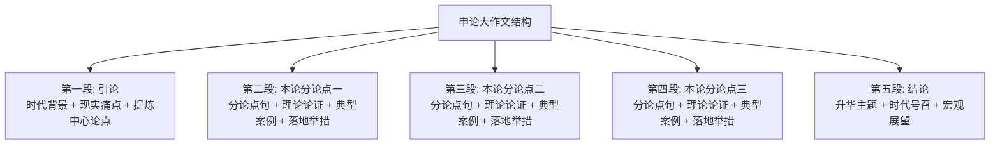

# 申论与综合应用能力解题公式

申论阅卷核心原则：**踩点给分、条理清晰、紧扣材料、语言官方**。

---

## 1. 申论答题底层逻辑（三步法）

### 审题五要素
1. **题型**：归纳概括、综合分析、提出对策、公文写作、大作文。
2. **作答对象**：原因、问题、影响（积极/消极）、经验、举措、特点等。
3. **给定资料范围**：明确依据资料几还是全篇资料。
4. **字数限制**：小题一般 150~300 字，大作文 1000~1200 字，留有 10% 上下浮动空间。
5. **特殊要求**：全面准确、条理清晰、有针对性、格式规范。

---

## 2. 申论四大常规小题型答题公式

### ① 归纳概括题
- **公式**：**核心总括词/短语 + 具体事实要点阐述**。
- **范例结构**：
  - 一是**强化制度建设**。健全相关法律法规，完善监督管理机制；
  - 二是**加大资金投入**。设立专项扶持基金，拓宽融资渠道；
  - 三是**注重人才引育**。实施引才工程，开展专业技能培训。

### ② 综合分析题（词句解释 / 评析态度）
- **步骤**：
  1. **释义/表态**：点明该词句的本质含义或对该现象明确表明态度（正确、片面、积极推动）。
  2. **多维论证**：分析背景、原因、现状、积极影响或消极危害。
  3. **总结对策**：提炼解决举措或总结升华。

### ③ 提出对策题
- **来源**：直接提取材料对策 + 问题反推对策 + 经验推广 + 结合实际常识补充。
- **维度**：思想认识、制度法规、监管执行、技术创新、资金人才、宣传引导。

### ④ 公文写作 / 贯彻执行题
- **基本格式**：
  - **标题**：发文单位 + 关于 + 事由 + 文种（如《关于开展垃圾分类专项整治工作的通知》）。
  - **称谓**：顶格书写（如：各部门、广大市民朋友们：）。
  - **正文**：
    - 发文背景 / 目的 / 依据；
    - 具体事项 / 措施 / 要求（分条罗列）；
    - 结语 / 号召（特此通知 / 让我们携手共建...）。
  - **落款与日期**：右对齐署名及发文日期（按题目要求决定是否省略）。

---

## 3. 申论大作文：五段三分式高分模板

### 拟定标题原则
- **对仗式**：*以文化人润心田 守正创新谱新篇*
- **动宾主副标题式**：*汇聚向新力 激发新动能 —— 浅谈以新质生产力赋能经济高质量发展*

### 分论点提炼维度（角度法）
- **主体维度**：政府引领、企业主体、社会协同、群众参与。
- **层面维度**：筑牢思想之基、健全制度之梁、插上科技之翼。
- **过程维度**：源头治理强预防、过程监管抓执行、末端落实重长效。
