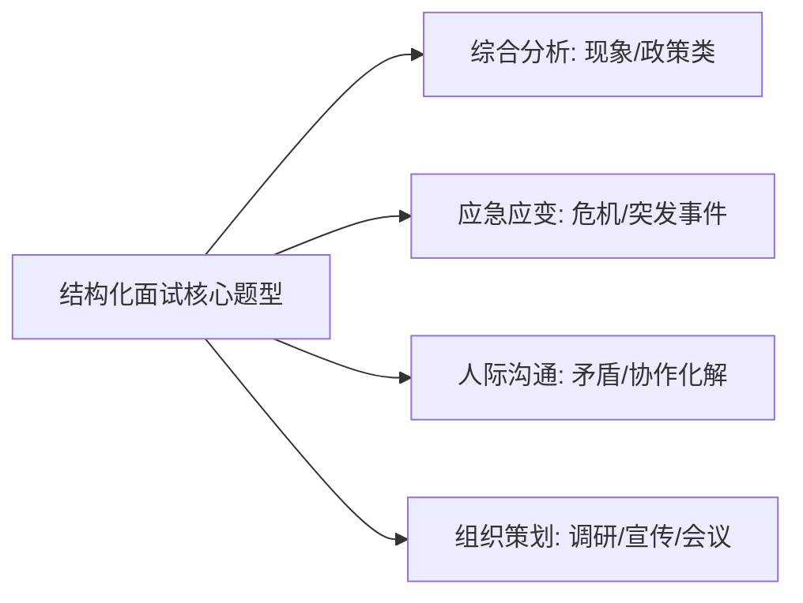

# 结构化面试通关指南与高分话术

公务员与事业单位面试考查：**政治站位、逻辑思维、应急应变、语言表达与公职形象**。

---

## 1. 结构化面试四大经典题型与破题模型

### ① 综合分析（现象/政策类）—— “五步破题法”

1. **点明本质（扣帽子）**：高度评价该政策/现象的时代背景、积极价值或实质危害。
2. **深入剖析（挖根源）**：从思想、制度、利益、监管、技术等维度分析原因。
3. **论证影响（谈利弊）**：分析其对群众福祉、社会治理、经济发展的深远意义或风险。
4. **抓落实促发展（提对策）**：针对问题提出多维度、可落地的解决路径。
5. **总结升华（表决心）**：结合自身岗位职责，表达践行使命的担当。

### ② 应急应变与危机处理 —— “黄金四步法”

1. **控制现场 / 稳定情绪**：第一时间赶赴现场，安抚当事人情绪，防止事态扩大。
2. **分级处置 / 调查核实**：按照轻重缓急处置关键问题（救人/疏导/核实信息）。
3. **协同联动 / 彻底解决**：调配资源，联络相关部门联合执法或解决诉求。
4. **长效防范 / 复盘汇报**：形成工作报告，完善应急预案，举一反三健全长效机制。

### ③ 人际沟通与情商协调 —— “阳光心态三原则”

1. **服从大局，态度诚恳**：以工作为重，不计较个人得失，理性看待分歧。
2. **换位思考，反思自身**：理解领导的严要求、同事的难处或群众的情绪，查找自身在沟通和工作中的不足。
3. **主动沟通，推进落实**：选择合适时机汇报解释或提供协助，化解误会，高质量完成工作。

### ④ 组织策划与活动实施 —— “全周期三阶段”

- **事前筹备**：明确主题、目标、时间、地点、参与人员、预算及物资方案。
- **事中把控**：明确分工，设立应急小组，确保现场秩序，做好过程记录与互动。
- **事后转化**：整理活动资料与新闻简报，评估实际成效，建立常态化工作机制。

---

## 2. 考场答题亮点与高分表达金句

### 破题金句库

- **谈为民服务**：“民之所忧，我必念之；民之所盼，我必行之。基层工作千头万绪，归根到底就是千家万户的事。”
- **谈担当作为**：“刀在石上磨，人在事上练。面对新形势新任务，必须克服本领恐慌，以钉钉子精神抓好工作落实。”
- **谈作风建设**：“天下大事，必作于细。细节决定成败，作风关系人心，要严把政策关、流程关、纪律关。”

---

## 3. 考场行为举止与脱敏训练建议

1. **外在形象**：着装得体（正装/沉稳商务休闲），坐姿挺拔，目光注视主考官及各位考官。
2. **语言习惯**：语速适中（每分钟约 200~220 字），杜绝“嗯、啊、这个、那个”等口癖。
3. **逻辑词使用**：多用“第一、第二、第三”或“在思想上、在制度上、在执行上”构建层次感。
