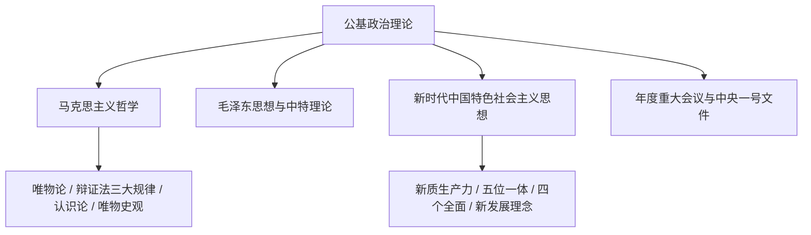

# 公共基础知识与法律公文备考指南

公共基础知识（公基）是事业单位统考、单招、文职及部分省份公务员考试（如三支一扶、村官）的核心科目，涵盖**政治理论、法学基础、公文写作与处理、管理常识、科技人文**等内容。

---

## 1. 政治理论与时政核心架构

### 马克思主义哲学必考考点

1. **物质与意识的辩证关系**：物质决定意识，意识对物质具有反作用（能动作用），一切从实际出发、实事求是。
2. **对立统一规律（唯物辩证法实质与核心）**：
   - **矛盾的普遍性与特殊性**：共性与个性、一般与个别（矛盾普遍性寓于特殊性之中）。
   - **主次矛盾与矛盾的主次方面**：抓重点（看主要矛盾）、看主流（看矛盾主要方面）。
3. **认识论核心规律**：实践是认识的基础（来源、动力、唯一标准、目的），认识具有反复性与无限性。

---

## 2. 法律常识核心高频考点

### ① 宪法与监察法
- **宪法地位**：国家根本大法，具有最高法律效力。全国人大常委会拥有宪法解释权；全国人大拥有宪法修改权（提议：常委会或 $1/5$ 以上代表；通过：全体代表的 $2/3$ 以上多数）。
- **监察委员会**：各级监察委员会是行使国家监察职能的专责机关，与国家审判机关、检察机关、执法部门互相配合、互相制约。

### ② 民法典（重点考点速记）
- **民事权利能力与行为能力**：
  - **自然人权利能力**：始于出生，终于死亡。胎儿在遗产继承、接受赠与时视为具有民事权利能力。
  - **行为能力分级**：
    - 无民事行为能力人：$< 8$ 周岁；或不能辨认自己行为的成年人（法定代理人实施）。
    - 限制民事行为能力人：$8 \le \text{年龄} < 18$ 周岁（可独立实施纯获利益或与其智力/精神状态相适应的民事法律行为）；$16 \le \text{年龄} < 18$ 周岁以自己劳动收入为主要生活来源的视为完全民事行为能力人。
    - 完全民事行为能力人：$\ge 18$ 周岁。
- **侵权责任归责原则**：过错责任原则、无过错责任原则（产品责任、高度危险作业、环境污染、饲养动物致损）。

### ③ 刑法要点
- **刑事责任年龄**：
  - $\ge 16$ 周岁：完全负刑事责任。
  - $14 \le \text{年龄} < 16$ 周岁：犯**故意杀人、故意伤害致人重伤或者死亡、强奸、抢劫、贩卖毒品、放火、爆炸、投放危险物质罪**八大罪负刑事责任。
  - $12 \le \text{年龄} < 14$ 周岁：犯故意杀人、故意伤害罪致人死亡或特别残忍手段致严重残疾，情节恶劣，经最高人民检察院核准追诉的应当负刑事责任。
- **正当防卫与紧急避险**：
  - **正当防卫**：针对不法侵害人本人；无限防卫权适用（行凶、杀人、抢劫、强奸、绑架及其他严重危及人身安全的暴力犯罪）。
  - **紧急避险**：针对第三人合法权益；危险不能由避险人直接引发，且损害必须小于所保全的利益；职务或业务上有特定义务的人不适用。

---

## 3. 党政机关公文写作与处理规范

依据《党政机关公文处理工作条例》，公文种类共有 **15 种**。

| 公文文种 | 适用范围与特征 | 行文方向 |
| :--- | :--- | :--- |
| **决议** | 经会议讨论通过的重大决策事项 | 下行文 |
| **决定** | 对重要事项作出决策和部署、奖惩有关单位和人员、变更或撤销下级不适当决定 | 下行文 |
| **命令 (令)** | 公布行政法规和规章、宣布施行重大强制性措施、嘉奖有关单位及人员 | 下行文 |
| **公报** | 公布重要决定或者重大事项（如统计公报、全会公报） | 下行文 / 普发 |
| **公告** | 向国内外宣布重要事项或者法定事项 | 泛发文 |
| **通告** | 在一定范围内应当遵守或者周知的事项 | 泛发文 |
| **意见** | 对重要问题提出见解和处理办法 | 上行 / 下行 / 平行文 |
| **通知** | 发布、传达要求下级机关执行和有关单位周知或者执行的事项，批转、转发公文 | 下行文 / 平行文 |
| **通报** | 表彰先进、批评错误、传达重要精神和告知重要情况 | 下行文 |
| **报告** | 向上级机关汇报工作、反映情况，回复上级机关的询问（不含请批事项） | 上行文 |
| **请示** | 向上级机关请求指示、批准（一文一事、只报送一个主送机关、不抄送下级） | 上行文 |
| **批复** | 答复下级机关请示事项 | 下行文 |
| **议案** | 各级政府向同级权力机关提请审议事项 | 上行文 |
| **函** | 不相隶属机关之间商洽工作、询问和答复问题、请求批准和答复审批事项 | 平行文 |
| **纪要** | 记载会议主要情况和议定事项 | 平行文 / 下行文 |

### 公文格式要素规范速记
- **版头**：份号、密级和保密期限、紧急程度、发文机关标志、发文字号（如：`国发〔2026〕1号`）、签发人（上行文必须标注）。
- **主体**：标题（发文机关 + 关于 + 事由 + 文种）、主送机关（编排于标题下空一行，顶格书写，后加冒号）、正文、附件说明、发文机关署名、成文日期（用阿拉伯数字将年月日标全，如 `2026年3月15日`）、印章。
- **版记**：抄送机关、印发机关和印发日期。
