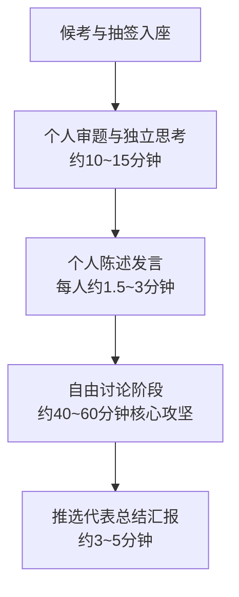

# 无领导小组讨论（LGD）面试实战指南

无领导小组讨论（Leaderless Group Discussion）广泛应用于**国考部委、选调生、税务系统、公安系统及省考重点岗位**。考查考生的**组织协调能力、洞察力、人际说服力、大局观与情绪控制**。

---

## 1. 无领导小组讨论标准流程

---

## 2. 团队角色定位与加分策略

| 角色定位 | 核心任务 | 适合人群与技巧 | 避坑禁忌 |
| :--- | :--- | :--- | :--- |
| **破冰者 / 引导者 (Leader)** | 率先破题、建立分类讨论标准与时间框架 | 气场强、大局观好；首位发言需提出可行的标准体系 | 严禁独断专行、强加观点、无理抢话 |
| **时间控制者 (Time-keeper)** | 把控阶段进度，适时提醒剩余时间与讨论主线 | 观察细致；在讨论僵持或偏题时主动切入拉回节奏 | 严禁机械化报时而不输出实质专业观点 |
| **内容贡献者 / 破局者 (Idea-maker)** | 提出新颖可行的观点与对策，化解分歧 | 逻辑严密、知识面广；提供折中整合方案 | 严禁长篇大论、偏离主题或抬杠争辩 |
| **总结陈词者 (Summarizer)** | 代表小组向考官全面呈现最终一致性成果 | 归纳提炼能力强、表达清晰；陈述全面兼顾全组成果 | 严禁夹带未形成共识的个人私货或漏讲重点 |

---

## 3. 常见题型与解题攻坚模型

### ① 开放式 / 排序选择类题目（最常见）
- **核心逻辑**：**“先定标准，再做归类，最后排序”**。
- **标准设立维度**：
  1. **必要性 / 紧迫性**（生命安全第一、不可逆后果优先）。
  2. **可行性 / 基础性**（制度资金保障、基础前置环节优先）。
  3. **长效性 / 辐射性**（长远制度建设、深远社会影响）。

### ② 资源争夺 / 角色扮演类题目
- **核心逻辑**：立足全局、求同存异。先阐述本部门需求合理性，再主动与其他部门资源协同互补，达成合作共赢方案。

---

## 4. 自由讨论阶段高分话术模板

- **当讨论偏离主题时（拉回主线）**：
  > “各位组员，大家的讨论非常热烈，但考虑到我们只有 40 分钟，目前核心争议在于第三项标准。建议我们先聚焦该项指标，达成共识后再推进后续环节，大家觉得如何？”

- **当出现两位组员激烈争论时（化解僵局）**：
  > “我觉得 2 号组员强调的‘资金投入前置’与 4 号组员提出的‘制度规范先行’并不矛盾，而是同一任务在不同推进阶段的侧重点。我们不妨将两者合并为‘软硬件协同保障’维度，既兼顾了效率又保障了合规。”

- **当补充边缘组员时（展现团队包容度）**：
  > “刚才 5 号组员提到的一个视角非常深刻，由于时间关系可能还没展开，我们不妨听听 5 号组员对这一点的具体补充。”
