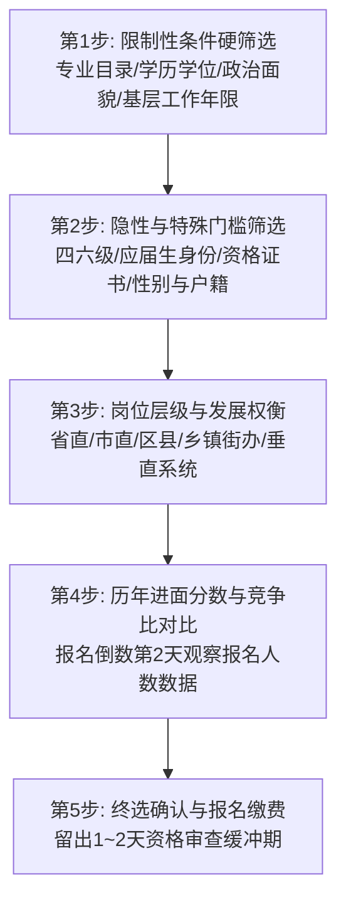

# 公考选岗报考与体检政审避坑指南

公考界流传：“**考得好不如报得好，笔试面试第一不如体检政审合规**”。科学选岗能直接降低竞争压力，严格遵守体检政审规范能确保顺利录用上岸。

---

## 1. 黄金选岗决策漏斗（五步筛选法）

### 选岗避坑关键技巧
1. **专业匹配度（严格对齐专业代码）**：
   - 区分“专业（大类）”与“具体二级专业”。若招考简章要求“计算机类”，则其下二级专业均可报考；若明确指定“计算机科学与技术”，其他相近专业不可擅自报考，务必提前致电招考单位确认。
2. **应届生身份保全**：
   - 择业期（通常 2 年）内未落实工作单位、未缴纳社保（或未签订劳动合同）、档案保留在原学校或人才服务机构的毕业生，可报考应届生岗位。
3. **避开“三不限”神坑**：
   - 不限专业、不限学历（专科以上）、不限户籍经验的岗位往往报考人数突破数千人，进面分数虚高（通常 $\ge 140$ 分）。优先选择自身限制条件叠加最多的岗位（如：党员 + 应届生 + 法律职业资格证 A 证 + 硕士研究生）。

---

## 2. 体检关键指标与考前调理

公务员录用体检严格执行《公务员录用体检通用标准（试行）》及《特殊标准》（公安/司法警察）。

| 核心体检项目 | 常见易卡不合格指标 | 考前预防与调整策略 |
| :--- | :--- | :--- |
| **血压与心电图** | 偶发性高血压、窦性心动过速、期前收缩 | 考前忌熬夜、忌浓茶与咖啡；现场若紧张可申请静坐复测 |
| **生化与肝功能** | 转氨酶 (ALT/AST) 偏高、胆红素偏高 | 体检前 2 周严禁饮酒、停用伤肝药物；清淡饮食、充足睡眠 |
| **血常规与血糖** | 白细胞计数异常、空腹血糖超标 | 避开感冒发炎期体检；体检前日 20:00 后禁食禁水 |
| **尿常规** | 尿蛋白阳性、潜血/白细胞异常 | 采中段尿；避免剧烈运动；女性避开生理期（可向考官申请延检） |
| **视力要求 (特殊标准)** | 人民警察单侧裸眼视力低于 4.8（法医/网安等除外） | 提前半年至一年做好视力矫正手术准备（按具体省份招考公告执行） |

---

## 3. 政治考察（政审）档案与背景核查要点

政审主要采取**函调、面谈、查阅个人人事档案、走访调查、无犯罪记录核查**等形式。

### 政审重点核查清单
- **档案三龄两历一身份**：
  - 年龄、工龄、党龄；
  - 学历经历、工作经历；
  - 干部/党员身份。
  - *重点核查：入党志愿书是否完整、学籍表与毕业成绩单是否齐全、工作离职证明与社保记录是否连续一致。*
- **违法违纪与涉案记录**：
  - 本人受过刑事处罚、行政拘留、开除党籍/公职处分；
  - 正在被立案调查或涉嫌违法违纪尚未结案。
- **直系亲属背景（特殊机关如公安/国安/机要）**：
  - 直系血亲或对本人有重大影响的旁系血亲有危害国家安全罪行，或正在服刑者，按相关特殊岗位规定执行严格背景审查。
