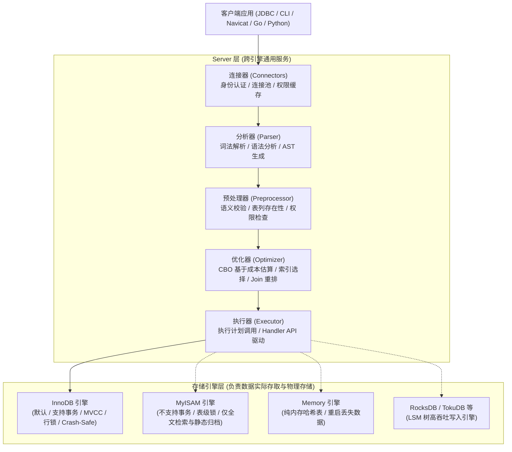
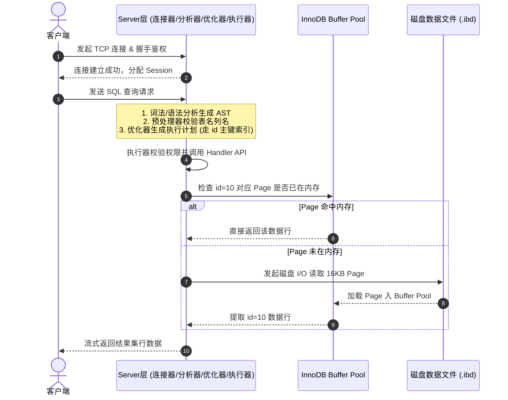
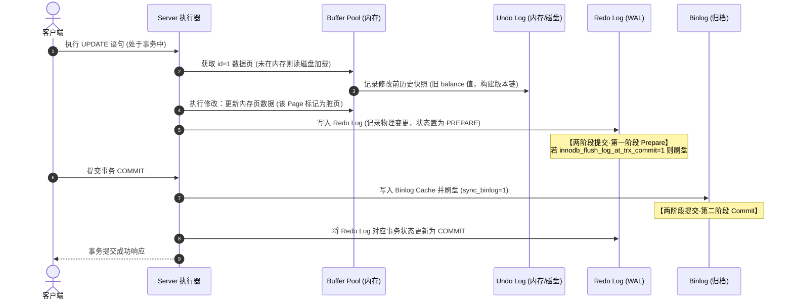
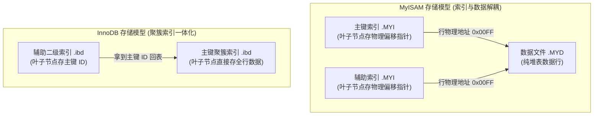

## MySQL 体系架构与 SQL 执行链路

理解 MySQL 的核心第一步，是建立宏观的架构认知。MySQL 采用了经典的**插件式存储引擎（Pluggable Storage Engine）**架构，将逻辑层（Server 层）与物理数据存取层（Storage Engine 层）彻底解耦。

---

## 一、 MySQL 分层架构全景

MySQL 整体由 **Server 层** 和 **存储引擎层（Storage Engine）** 两大层次构成：

### 1. 连接器（Connectors）

连接器负责与客户端建立 TCP 连接、获取用户权限、维持并管理连接上下文。

- **握手与认证**：验证客户端用户名、密码与主机网段。
- **权限快照**：连接建立成功后，连接器会一次性读取该用户的权限并保存在连接会话内存中。后续只要该连接未断开，即使用管理员 `GRANT` 或 `REVOKE` 修改了权限，该连接的权限也不会即时改变。
- **长连接与内存膨胀**：MySQL 执行过程中使用的临时内存是在连接对象内部分配的。长连接累积使用可能导致内存占用过大，最终被操作系统 OOM Killer 杀掉。生产环境建议定期断开长连接，或在执行大操作后通过 `mysql_reset_connection()` 重置连接上下文。
- **线程池（Thread Pool）**：默认模式下一个连接对应一个 OS 线程（`one-thread-per-connection`），瞬时高并发会引发“连接风暴”导致线程上下文切换拖垮 CPU。生产高并发场景推荐开启商业版或 Percona/MariaDB 的线程池插件。

### 2. 查询缓存（Query Cache，8.0 已彻底移除）

- **工作机制**：MySQL 会将 `SELECT` 语句及其结果以 Key-Value 形式缓存在内存中。
- **为什么在 MySQL 8.0 彻底被废除**：
  - **失效极其频繁**：只要一张表发生了一次写入（`INSERT`/`UPDATE`/`DELETE`），该表所有关联的查询缓存立刻全部清空失效。在写多读少或中等写负载的业务库中，查询缓存的命中率极低，反而增加了锁竞争与内存维护开销。
  - 现代应用架构普遍将读缓存前置到 Redis/Memcached 集中式缓存层，由业务按需精准控制缓存失效与穿透。

### 3. 分析器（Parser）

分析器负责将客户端传来的文本 SQL 字符串解析为内部结构：

- **词法分析（Lexer）**：识别 SQL 字符串中的关键字、表名、字段名、运算符，转化为一个个 Token。
- **语法分析（Yacc Parser）**：依据 SQL 语法规则检查 SQL 是否合法，并构建出一棵**抽象语法树（Abstract Syntax Tree, AST）**。若存在语法错误，在此阶段直接抛出 `You have an error in your SQL syntax`。

### 4. 预处理器（Preprocessor）

预处理器进一步对 AST 进行语义维度的深化审查：

- **元数据校验**：检查 AST 中引用的数据库表、字段是否存在。
- **别名解析**：展开通配符（如 `SELECT *` 展开为全字段列表）。
- **权限初审**：预先校验当前用户对目标表是否具备基本的查询/修改权限。

### 5. 查询优化器（Optimizer）

优化器的目标是将抽象语法树转化为一条**执行成本最低、效率最高**的物理执行计划。

- **CBO（Cost-Based Optimizer）基于成本的优化模型**：
  优化器会根据数据字典、表的统计信息（Cardinality 基数、页分布）计算不同执行方案的代价：
  - **I/O 代价**：从磁盘加载物理页到 Buffer Pool 的成本（默认一个页为 1.0）。
  - **CPU 代价**：在内存中检索行记录、比对过滤条件的成本（默认处理一条记录为 0.2）。
- **优化器核心决策**：
  - **多索引选择**：决定走哪个索引，还是直接走聚簇索引全表扫描。
  - **多表 Join 驱动顺序调整**：在等值连接时，根据表规模与过滤条件自动选择“小表驱动大表”。
  - **子查询扁平化与半连接（Semi-Join）转换**：将 `IN (SELECT ...)` 优化为关联查询或物化表。
- **为什么优化器会选错索引**：
  - 统计信息（`ANALYZE TABLE`）滞后导致基数估算失准。
  - 优化器认为主键回表的随机 I/O 成本高于全表扫描的顺序 I/O 成本。

### 6. 执行器（Executor）

执行器是真正运转执行计划的核心控制器：

- **权限复查**：在正式调用引擎接口前，再次校验针对表或视图的操作权限。
- **Handler API 调用**：执行器并不关心数据底层是 B+ 树还是哈希表，它统一定义了一套标准的存储引擎接口规范（Handler API），例如 `ha_innobase::index_read`、`ha_innobase::rnd_next` 等。
- **火山/迭代器模型（Iterator Model）**：从根算子向下驱动，逐行拉取数据并判定过滤条件，满足条件的行写入结果缓冲区，流式返回客户端。

---

## 二、 一条查询 SQL 的物理执行全流程

以简单查询语句 `SELECT username, age FROM users WHERE id = 10;` 为例，其端到端执行轨迹如下：

---

## 三、 一条更新 SQL 的物理执行全流程（事务与两阶段提交）

以更新语句 `UPDATE account SET balance = balance - 100 WHERE id = 1;` 为例，该过程串联了 **Buffer Pool、Undo Log、Redo Log 与 Binlog**，是保证 ACID 和 Crash-Safe 的核心通路：

### 崩溃恢复关键点说明

当数据库意外宕机重启时，根据两阶段提交的标志进行故障恢复判断：

1. **若 Redo Log 为 Prepare 状态且 Binlog 未写入完成**：该事务判定为未提交，利用 Undo Log 执行回滚，保证原子性。
2. **若 Redo Log 为 Prepare 状态但 Binlog 已经完整写入**：虽然 Redo 尚未变成 Commit，但由于 Binlog 已经落盘，从库可能已经同步该事务，因此奔溃恢复机制会将该事务在存储引擎层直接 Commit，保证主从数据严格一致。

---

## 四、 常见存储引擎深度横向对比

MySQL 插件式架构支持灵活更换存储引擎。生产环境中主要接触 **InnoDB**、**MyISAM**、**Memory** 以及在大数据量追加写场景下的 **RocksDB (MyRocks)**。

### 1. 核心维度对比矩阵

| 特性维度 | InnoDB | MyISAM | Memory | RocksDB (MyRocks) |
| :--- | :--- | :--- | :--- | :--- |
| **事务支持** | 完整支持（ACID） | 不支持 | 不支持 | 完整支持（ACID） |
| **锁粒度** | 行级锁（Row Lock）+ 间隙锁 | 表级锁（Table Lock） | 表级锁（Table Lock） | 行级锁（Row Lock） |
| **MVCC 并发读** | 支持（一致性非锁定读） | 不支持 | 不支持 | 支持 |
| **崩溃恢复能力** | 支持（Crash-Safe 依靠 Redo/双写） | 不支持（崩溃易损坏索引） | 重启数据彻底丢失 | 支持（WAL 机制） |
| **底层数据结构** | B+ 树（聚簇索引结构） | B+ 树（堆表 + 独立索引） | 哈希表（Hash Index）/ B 树 | LSM 树（Log-Structured Merge-Tree） |
| **外键约束** | 完整支持 | 不支持 | 不支持 | 不支持 |
| **物理文件结构** | `.ibd`（数据与索引合一） | `.MYD`（数据）+ `.MYI`（索引） | 无独立磁盘数据文件 | `.sst` 物理数据文件 |
| **主键要求** | 必须有主键（无则自动生成隐藏主键） | 可无主键 | 可无主键 | 推荐有主键 |
| **`COUNT(*)` 效率** | 需扫描聚簇/辅助索引实时计算 | 磁盘直接保存表总行数（无 `WHERE` 时 $O(1)$） | 实时计算 | 估算或按需扫描 |

### 2. MyISAM 与 InnoDB 核心差异底层剖析

#### （1）物理存储模型差异

- **MyISAM（非聚簇堆表）**：
  数据与索引完全分离。`.MYD` 文件中各行记录按插入顺序堆叠存放；`.MYI` 索引文件中 B+ 树叶子节点存储的全部是**指向数据行在 `.MYD` 文件中的物理字节偏移量（Pointer）**。
- **InnoDB（聚簇索引表）**：
  数据本身就是索引的一部分。主键 B+ 树的叶子节点直接存放整行完整数据（Clustered Index）；辅助索引叶子节点存放的是主键值，需要经过一次**主键回表**。

#### （2）为什么 InnoDB 的 `COUNT(*)` 无法像 MyISAM 一样瞬间返回

- **MyISAM 表**：因为不支持事务，且整张表只能加表锁，表上的总行数对于所有客户端都是完全相同的确定值，因此引擎直接在元数据头里维护了 `row_count` 计数器，无过滤条件时读取时间复杂度为 $O(1)$。
- **InnoDB 表**：由于支持 MVCC 与多版本并发事务，在某一具体时刻，不同事务由于隔离级别不同（如 Read View 活跃事务不同），所能读取到的行数是不一样的。因此，InnoDB 必须通过遍历索引树（通常优先挑选体积最小的二级辅助索引全量遍历）逐行比对事务可见性，无法维护一个静态全局计数器。
