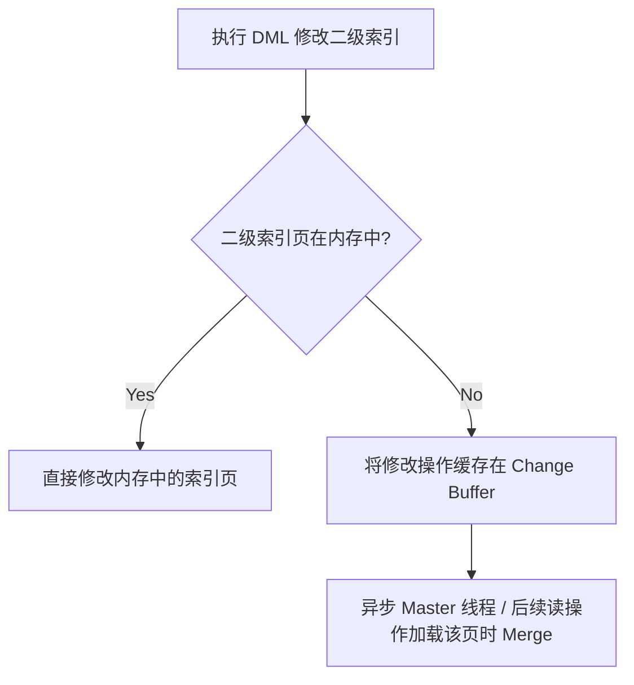
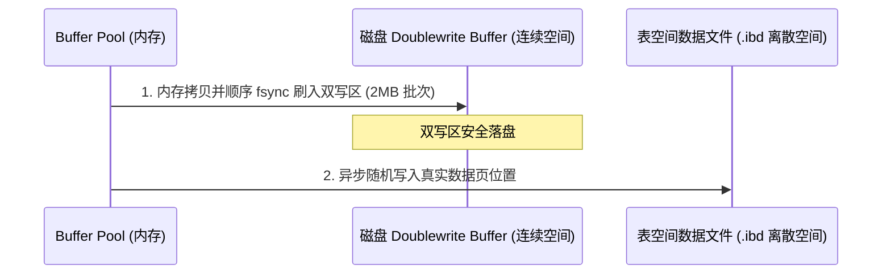
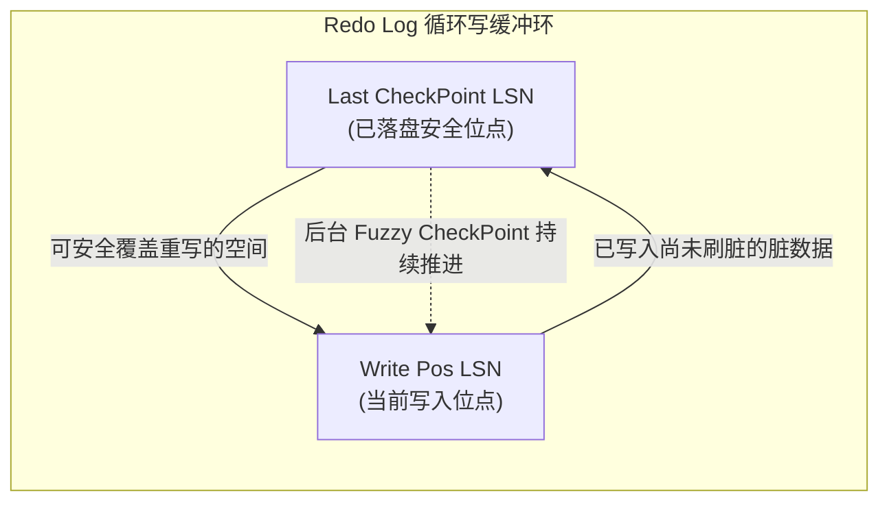
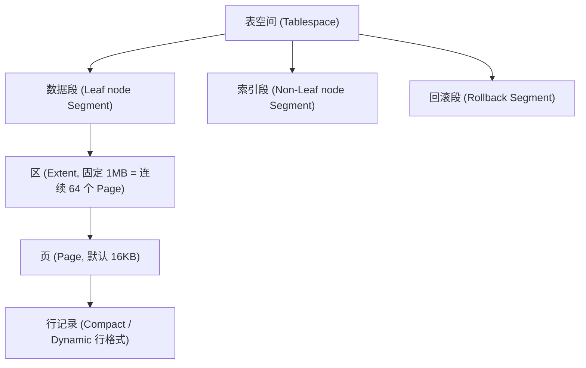

## InnoDB 存储引擎内核原理

作为 MySQL 的默认存储引擎，InnoDB 的高性能与高可靠性源于其精妙的底层物理存储结构与缓冲/写优化机制。本章深入剖析 InnoDB 的物理页结构、行记录格式、Change Buffer 写缓冲以及 Doublewrite Buffer 双写缓冲区。

---

## 一、 InnoDB 物理 Page 页结构

InnoDB 存储数据的基本单位是**页（Page）**，默认大小为 **16KB**。一个 Page 在磁盘上的物理结构由以下 7 个核心区域组成：

```text
+-----------------------------------+
|  File Header (文件头 - 38B)       | -> 记录页的校验和、页号、双向链表前后指针
+-----------------------------------+
|  Page Header (页头 - 56B)         | -> 记录页内记录数量、槽（Slot）数量等
+-----------------------------------+
|  Infimum + Supremum (最小/最大记录)| -> 虚拟的边界记录，界定用户记录的头尾
+-----------------------------------+
|  User Records (用户记录)          | -> 真正存储行数据的地方，按主键单链表相连
+-----------------------------------+
|  Free Space (空闲空间)            | -> 尚未被使用的空白内存空间
+-----------------------------------+
|  Page Directory (页目录)          | -> 槽位索引，用于在页内进行二分查找
+-----------------------------------+
|  File Trailer (文件尾 - 8B)       | -> 校验刷盘完整性的校验码
+-----------------------------------+
```

### 1. 页目录（Page Directory）二分检索机制

如果一个页内存储了数百条记录，要在页内查找某条记录，若从头顺着单链表往后遍历，时间复杂度为 $O(N)$，效率低下。
为此，InnoDB 设计了 **Page Directory**：
- **记录分组**：页内的记录被分为若干个组，每个组包含 4~8 条记录。
- **槽位（Slot）映射**：每个组中主键值最大的那条记录（即组内最后一条记录）在页的尾部 **Page Directory** 里对应一个槽位，记录其相对偏移量。
- **二分查找**：当检索某个主键时：
  1. 先在 Page Directory 的槽位数组里利用**二分法**快速定位其所属的槽（即确定数据在哪一个分组）。
  2. 找到槽后，拿着该槽前一个槽所指向的记录，作为该分组单链表的起点。
  3. 顺着单链表向后遍历该分组的几条记录，精准定位数据。
  通过这种设计，页内检索的时间复杂度瞬间降至 **$O(\log M)$**（$M$ 为槽的个数）。

### 2. 文件尾（File Trailer）校验机制

为了防范 16KB 页刷盘到磁盘中途遭遇断电等意外（Partial Page Write），`File Trailer` 包含了 8 字节的校验和（Checksum）及 LSN。
- 每次刷写时，页头和页尾都会记录相同的 Checksum 值。
- 重启自检时，如果页头 Checksum 与页尾不一致，说明该页刷写不完整（受损），系统将通过双写缓冲进行数据修复。

---

## 二、 InnoDB 行记录格式 (Row Format)

表中的具体行数据是在 Page 内的 `User Records` 区域存储的。InnoDB 支持多种行格式，最常用的是 **Compact** 和 **Dynamic**。

### 1. Compact 格式物理剖析

Compact 格式将行记录分为“记录的额外信息”和“记录的真实数据”两部分：

```text
+----------------------- 记录的额外信息 -----------------------+---------- 记录的真实数据 ----------+
| 变长字段长度列表 | NULL值列表 | 记录头信息 (5字节)             | DB_TRX_ID | DB_ROLL_PTR | 列1 | 列2 | ...
+--------------------------------------------------------------+-------------------------------------+
```

- **变长字段长度列表**：逆序存放所有变长字段（如 `VARCHAR`）在当前行的实际占用字节长度。
- **NULL 值列表**：用二进制位（Bit Map）记录哪些列的值是 NULL。每个 Bit 对应一个可为 NULL 的列，逆序排列。若列值为 NULL，对应 Bit 记为 1。
- **记录头信息 (Record Header - 5字节)**：
  - `delete_mask` (1-bit)：标记该行是否已被删除（逻辑删除）。
  - `n_owned` (4-bit)：该记录在 Page Directory 组内所占有的记录数。
  - `next_record` (16-bit)：指向下一条记录的**相对偏移量**（页内单链表指针）。

- **记录的真实数据**：
  - 除了我们定义的业务列外，还包含三个隐藏列：
    - `DB_TRX_ID` (6字节)：最近修改该行的事务 ID。
    - `DB_ROLL_PTR` (7字节)：回滚指针，指向 Undo Log。
    - `DB_ROW_ID` (6字节)：隐式自增 ID（在无显式主键/唯一索引时生成）。

### 2. 溢出页（Off-page）与 Dynamic 格式

- **行溢出成因**：MySQL 一个 Page 只有 16KB，如果某列数据（如 `VARCHAR(65535)` 或 `TEXT`）的宽度远大于 16KB，一页就装不下整行记录。
- **Compact 处理方案**：在 Compact 格式中，如果发生行溢出，行的真实数据处只存储该列的前 **768 字节**，并在末尾保留一个 20 字节的指针，指向其他溢出页（Overflow Page）。
- **Dynamic 格式（MySQL 8.0 默认）**：Dynamic 格式对大字段做了更彻底的优化。在行的真实数据处**完全不存储大字段的任何前缀数据**，只存储一个 20 字节的指针指向溢出页，所有大字段数据彻底移至外挂的溢出页中，进一步提高了缓存页的利用效率与扫描性能。

---

## 三、 写缓冲区 (Change Buffer)

当我们在表中插入、更新或删除一条记录时，除了要维护聚簇索引外，还需要更新表上的**非唯一二级索引**（Secondary Index）。
- **痛点**：非唯一二级索引的数据分布通常是极其无序和离散的。如果每次修改都直接去磁盘读取二级索引页并修改，会导致大量的**随机磁盘 I/O**，性能急剧下滑。
- **破局：Change Buffer**：
  当修改非唯一二级索引时，如果对应的索引页尚不在 Buffer Pool（内存）中，InnoDB 并不会立即从磁盘读取该页，而是**先将这个修改操作记录在 Change Buffer 中**。
  后续当该二级索引页由于其他查询被加载到内存中时，再执行 **Merge**（合并修改）。



### 1. 为什么唯一索引（Unique Index）无法使用 Change Buffer？

- **唯一性约束校验**：对于唯一索引，插入数据时必须判断该值在表中是否已存在。为了校验唯一性，InnoDB **必须先把对应的索引页从磁盘读入内存中**进行校验。
- **无缓冲必要**：既然索引页已经被强制读入了内存，那么直接在内存页中修改即可，完全不需要再放入 Change Buffer 去做延迟缓存。
- **结论**：Change Buffer 只对**非唯一二级索引**的写操作生效。

### 2. Change Buffer Merge 的触发时机

- **主动读取**：业务 SQL 查询了该二级索引页，导致其被加载到 Buffer Pool，此时顺便合并 Change Buffer 里的对应记录。
- **后台线程**：后台 Master Thread 定期进行异步 Merge。
- **安全关闭**：数据库正常 Shutdown 时，会强制将 Change Buffer 全量刷盘合并。

---

## 四、 双写缓冲区 (Doublewrite Buffer)

双写缓冲区是 InnoDB 保证数据持久性与 Crash-Safe 的核心基石，用于防范操作系统的 **Partial Page Write（部分页面写失效）**。

### 1. Partial Page Write（半写）灾难

- 操作系统的物理磁盘扇区一般是 512 字节，文件系统的 Page 一般是 4KB。
- InnoDB 的 Page 默认是 16KB。
- 当 InnoDB 将内存中的 16KB 脏页写入磁盘时，需要执行 4 次物理写入。如果写到一半（比如写了 8KB）时服务器断电，磁盘上的这个数据页就处于受损状态（LSN 校验错乱）。
- **Redo Log 此时无法救场**：Redo Log 记录的是增量修改（物理偏置日志）。如果基盘页本身已经残缺不全、物理结构错乱，Redo Log 就无法找到正确的偏移位置去应用重做，导致崩溃恢复失败。

### 2. 双写缓冲运行逻辑

双写缓冲区在磁盘上是一块连续的物理空间（大小为 2MB，划分为 128 个页）。
当脏页需要刷盘时：
1. **第一步（内存拷贝与顺序写）**：InnoDB 先将脏页拷贝到内存中的双写缓冲区，然后通过一次**顺序 I/O** 写入磁盘上连续的双写缓冲区（性能极高）。
2. **第二步（随机写表空间）**：在双写缓冲区数据成功落盘后，InnoDB 再将脏页异步随机写入到各自真实的 `.ibd` 表空间数据文件中。



### 3. 崩溃自愈逻辑

- 如果在**第二步**写数据文件时发生断电，导致 `.ibd` 页损坏：
  - 重启时，InnoDB 发现数据页的 Checksum 校验失败。
  - InnoDB 自动去磁盘 **Doublewrite Buffer** 中找到该页的**完整干净副本**，用其覆盖受损的 `.ibd` 数据页。
  - 页恢复完整后，再应用 Redo Log，顺利完成崩溃自愈。
- 如果在**第一步**写 Doublewrite Buffer 时断电：
  - 此时真实的数据文件 `.ibd` 页完好无损，重启后直接使用 Redo Log 就可以成功恢复。

---

## 五、 CheckPoint 检查点机制与刷脏原理

在 WAL（Write-Ahead Logging）机制下，事务提交时只要 Redo Log 落盘即可宣布成功，内存中的数据页（脏页）无需立即同步刷盘。但内存不能无限承载脏页，Redo Log 文件大小也是有限的。**CheckPoint（检查点）** 的核心作用就是将内存脏页刷入磁盘，并将对应的 Redo Log 空间标记为可循环复用。

### 1. 为什么必须推进 CheckPoint

- **缩短崩溃恢复时间**：重启恢复时，系统只需要从 CheckPoint 记录的 LSN 开始向后重放 Redo Log，CheckPoint 之前的脏页早已物理落盘，无需重复重放。
- **缓冲池内存置换**：当 Buffer Pool 内存不足需要淘汰旧页时，若淘汰的是脏页，必须触发 CheckPoint 刷盘。
- **防止 Redo Log 溢满**：Redo Log 采用环形写入，当最新写入的 LSN 快要追赶上最旧的 CheckPoint LSN 时，必须强制刷脏以释放日志空间。

### 2. Sharp CheckPoint vs Fuzzy CheckPoint

- **Sharp CheckPoint（尖锐检查点）**：
  在数据库正常关闭（Shutdown）时触发，将 Buffer Pool 中**所有的脏页全部一次性强制刷回磁盘**。
- **Fuzzy CheckPoint（模糊检查点）**：
  数据库正常运行期间绝不能使用 Sharp CheckPoint，否则会导致瞬时剧烈的 I/O 停顿。因此系统只按需分批次、异步地刷写部分脏页：
  - **Master Thread 检查点**：后台线程每隔 1 秒或 10 秒，异步从缓冲池的脏页列表中刷新一定比例的脏页。
  - **`FLUSH_LRU_LIST` 检查点**：当 Buffer Pool 中可用空闲页低于 `innodb_lru_scan_depth` 阈值时，淘汰 LRU 尾部页面并触发刷盘。
  - **脏页比例超标检查点**：当内存脏页占比超过 `innodb_max_dirty_pages_pct`（默认 75%）时，主动加速刷盘以腾挪空间。
  - **Async/Sync Flush 检查点**：当 Redo Log 剩余可用空间不足（如已用 75% 以上），为防止日志覆盖，强制挂起部分写入并全力刷脏。



---

## 六、 Undo Log 底层存储与 Purge 清理机制

Undo Log 不仅用于事务失败时的回滚操作，更是支撑 MVCC（多版本并发控制）一致性非锁定读的底层基石。

### 1. 回滚段（Rollback Segment）与 Undo 页

InnoDB 默认支持 128 个 Rollback Segment，每个 Rollback Segment 包含 1024 个 Undo Slot（槽位），最多支持数万个事务同时并行写入 Undo。

Undo Log 在物理层面分为两大类型：
- **Insert Undo Log**：
  记录插入语句产生的 Undo 记录。因为新插入的行仅对当前事务自身可见，一旦当前事务 `COMMIT`，没有任何其他并发事务可能需要读取该行的旧版本，因此 **Insert Undo Log 在事务提交后可被立即释放回收**。
- **Update Undo Log**：
  记录更新和删除产生的 Undo 记录。事务提交后，由于其他并发事务（根据 ReadView 活跃视界）仍可能需要沿着版本链读取该行的历史旧值，因此 **Update Undo Log 不能立即删除**，会被放入 Purge 队列中。

### 2. 后台 Purge 线程的异步清理

为了避免 Undo Log 无限膨胀拖垮磁盘，InnoDB 专门引入了后台 **Purge 线程**：

1. **版本链判定**：Purge 线程定期扫描系统中当前最老的活跃 ReadView（`low_limit_id`）。
2. **Undo 页物理回收**：如果某个 Update Undo Log 所属的事务 ID 已经早于系统内所有活跃事务，说明当前没有任何在线查询会再访问到该旧版本，Purge 线程将其从回滚段链表中彻底释放。
3. **彻底清除标记行（`delete-mark`）**：在 SQL 执行 `DELETE` 时，InnoDB 并不会立即从 B+ 树上物理删除行，而只是将记录头部的 `deleted_flag` 标记为 1。Purge 线程确认该记录不再被任何事务需要后，才会将其从 B+ 树叶子节点中物理抹除并将其空间合并入 Page 的 `Free Space`。

---

## 七、 InnoDB 表空间体系结构

从逻辑组织到物理磁盘，InnoDB 的存储组织分为五个递进层级：**表空间（Tablespace） $\to$ 段（Segment） $\to$ 区（Extent） $\to$ 页（Page） $\to$ 行（Row）**。



- **独立表空间（`file-per-table`）**：
  配置 `innodb_file_per_table=ON`（默认开启）。每张表拥有专属的 `表名.ibd` 文件，包含该表的数据、主键索引与二级索引。表删除（`DROP TABLE`）时操作系统可直接回收磁盘空间。
- **系统表空间（`ibdata1`）**：
  共享表空间，在 MySQL 5.7 之前存放数据字典、Doublewrite Buffer、Change Buffer 以及部分 Undo 日志。
- **区（Extent）的设计巧思**：
  为什么不按 Page 直接分配空间，而是引入 1MB（64 个连续页）的“区”？因为 B+ 树范围扫描时，若页在磁盘上完全离散，会产生可怕的随机 I/O；**按区分配能够保证 64 个页在物理磁盘柱面上严格连续，顺序预读性能提升数倍**。
