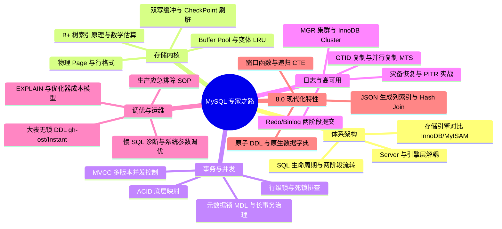

## MySQL 关系型数据库体系

本专题带你从底层的分层架构、SQL 物理执行链路、B+ 树与 InnoDB 存储引擎内核，一路深入到灾难备份、高可用拓扑、生产排障与 MySQL 8.0 现代化新特性。

---

## 🗺️ MySQL 核心进阶地图

---

## 🚀 第一阶段：内核基础与存储引擎 (Storage Engine)

- [体系架构与 SQL 执行链路](./0-core/1-architecture.md)：Server 层五大组件分工、一条查询/更新 SQL 的物理生命周期与主流存储引擎全面对比。
- [索引原理、Buffer Pool 及 AHI](./0-core/2-index-engine.md)：为什么是 B+ 树？解密聚簇索引、自适应哈希索引与变体 LRU 淘汰缓存池。
- [InnoDB 存储引擎内核原理](./0-core/3-innodb-internals.md)：底层物理 Page 页结构、行格式（Compact/Dynamic）细节与 Change Buffer、Doublewrite Buffer 底层实现。
- [MVCC 与锁机制深度解析](./0-core/4-mvcc-locks.md)：读已提交、可重复读、ReadView 算法与自增锁/死锁排查与线上死锁日志剖析。
- [日志体系与复制原理](./0-core/5-logs-replication.md)：深入 Redo Log MTR 机制、Binlog 三阶段组提交（2PC）。

---

## 🏗️ 第二阶段：日志体系与高可用 (Reliability)

- [高可用与集群架构](./2-ha/11-ha-clustering.md)：深入 MGR (MySQL Group Replication) 原生分布式事务集群、InnoDB Cluster 全栈自动化部署及代理层路由 (ProxySQL/MySQL Router)。
- [灾备恢复、GTID 复制与高可用架构](./2-ha/12-dr-backup-recovery.md)：深入 GTID 自动定位、从库并行复制（MTS）三代演进、物理备份 XtraBackup 与 PITR 时间点恢复、主流高可用方案（Orchestrator/MHA/MGR）对比。
- [分库分表与读写分离实战](./1-tuning/8-sharding.md)：主从延迟应对、垂直水平拆分、全局 ID 与跨库查询破局、不停机双写扩容平滑迁移。

---

## ⚡ 第三阶段：性能诊断与生产运维 (Tuning & Operations)

- [MySQL SQL 调优与执行计划](./1-tuning/6-sql-tuning.md)：深入剖析 `EXPLAIN` 解析、索引失效场景与进阶实战技巧。
- [MySQL 性能调优与参数调优](./1-tuning/7-optimization.md)：执行计划详解、生产慢查询优化，以及 InnoDB 核心参数（Buffer Pool/Thread/IO）运维调优指南。
- [生产排障、无锁 DDL 与应急 SOP](./1-tuning/9-troubleshooting.md)：大表无锁 DDL 演进（`gh-ost` vs `pt-osc` vs Instant DDL）、`SHOW ENGINE INNODB STATUS` 深度解密、`sys` 库排障与 CPU/连接数爆满应急 SOP。
- [MySQL 8.0 现代核心特性全解](./1-tuning/10-mysql8-features.md)：原生数据字典与原子 DDL、窗口函数实战、通用表表达式 CTE、JSON 虚拟生成列索引与 Hash Join 机制。
- [MySQL 核心面试真题复盘](../../interview/database/7-interview-mysql.md)：高频大厂必考点汇总，包含 MVCC、幻读解决、2PC 必要性、页分裂与双写等硬核剖析。
