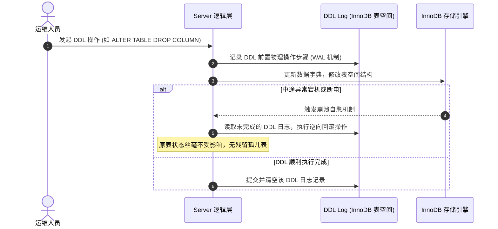

## MySQL 8.0 现代核心特性全解

MySQL 8.0 是 MySQL 发展史上的一次里程碑式跃迁。它彻底重构了底层元数据存储体系，补齐了分析型查询利器（窗口函数、CTE），革新了 Join 执行器（Hash Join），并赋予了半结构化 JSON 数据媲美关系表的索引检索性能。

---

## 一、 原生数据字典与原子 DDL

在 MySQL 5.7 及更早版本中，元数据分散存放在文件系统的 `.frm` 文件、MyISAM 系统表以及 InnoDB 内部字典中。这导致执行 DDL 时极易出现“脑裂”现象（例如修改表结构途中服务器断电，可能导致 `.frm` 丢失或遗留孤儿临时表）。

### 1. 彻底废除 `.frm` 文件

MySQL 8.0 引入了**统一的原生数据字典（Data Dictionary）**：

- **全部元数据统一落盘于 InnoDB**：原本散落于操作系统的表结构定义（`.frm`）、分区定义（`.par`）、触发器定义（`.TRG`）全部被废弃，统一定义为 InnoDB 内部的系统表（存在于 `mysql.ibd` 表空间中）。
- **对外视图透明化**：通过标准的 `information_schema` 进行只读访问，元数据查询直接走内存缓存，性能提升百倍。

### 2. 原子 DDL（Atomic DDL）机制

MySQL 8.0 使得所有的 DDL 操作支持完全的 **ACID 事务原子性**：

```sql
-- 若在 5.7 中执行，若 t2 存在而 t1 不存在，会报错但已删除的表无法回滚
-- 在 8.0 中，整条 DDL 具备原子性：要么全成功，要么全回滚！
DROP TABLE IF EXISTS t1, t2;
```



---

## 二、 窗口函数（Window Functions）实战

窗口函数（也称分析函数）极大地简化了复杂统计逻辑。不同于普通 `GROUP BY` 会把多行折叠合并为一行，**窗口函数为每一行记录返回一个计算结果，且能同时保留当前行的完整明细**。

### 1. 核心排序函数对比

针对报表中最常见的“组内 Top N”排行：

| 函数 | 特点 | 示例数据 (100, 100, 90) 的排名结果 |
| :--- | :--- | :--- |
| **`ROW_NUMBER()`** | 严格递增序号，即使数值相同排名也不重复 | `1, 2, 3` |
| **`RANK()`** | 相同数值并列排名，后续排名跳跃跳号 | `1, 1, 3` |
| **`DENSE_RANK()`** | 相同数值并列排名，后续排名连续不跳号 | `1, 1, 2` |

#### 实战案例：查询每个部门工资最高的前 3 名员工

在没有窗口函数的 MySQL 5.7 中，需要编写极其复杂的自关联和关联子查询；在 MySQL 8.0 中一行即可搞定：

```sql
WITH RankedEmployees AS (
    SELECT 
        emp_id,
        emp_name,
        department_id,
        salary,
        DENSE_RANK() OVER (
            PARTITION BY department_id 
            ORDER BY salary DESC
        ) AS rank_num
    FROM employees
)
SELECT * 
FROM RankedEmployees 
WHERE rank_num <= 3;
```

### 2. 偏移分析函数（`LEAD` / `LAG`）

用于获取当前行的前第 N 行或后第 N 行数据，常用于计算环比、同比、用户连续留存：

```sql
SELECT 
    order_date,
    revenue,
    LAG(revenue, 1) OVER (ORDER BY order_date) AS prev_day_revenue,
    (revenue - LAG(revenue, 1) OVER (ORDER BY order_date)) AS daily_growth
FROM daily_sales;
```

---

## 三、 通用表表达式（CTE）

通用表表达式（Common Table Expressions, CTE）是一种在单条查询语句内定义局部临时命名结果集的技术，极大地提升了复杂 SQL 的可读性与复用性。

### 1. 非递归 CTE：消除多层派生表黑洞

```sql
WITH 
    HighSpendingUsers AS (
        SELECT user_id, SUM(amount) AS total_spent 
        FROM orders 
        GROUP BY user_id 
        HAVING total_spent > 10000
    ),
    ActiveUsers AS (
        SELECT user_id 
        FROM user_login_log 
        WHERE login_time >= NOW() - INTERVAL 7 DAY
    )
SELECT u.user_id, u.username, h.total_spent
FROM users u
JOIN HighSpendingUsers h ON u.user_id = h.user_id
JOIN ActiveUsers a ON u.user_id = a.user_id;
```

### 2. 递归 CTE：无限层级树形结构遍历

针对企业组织架构树、评论楼中楼、省市区三级联动等场景，递归 CTE 允许直接递归向下或向上遍历：

```sql
-- 递归遍历获取 ID=1 经理名下的所有下属员工 (树形全链路展开)
WITH RECURSIVE SubordinateTree AS (
    -- 初始锚点查询 (Anchor Member)
    SELECT emp_id, emp_name, manager_id, 1 AS level
    FROM employees
    WHERE emp_id = 1

    UNION ALL

    -- 递归迭代成员 (Recursive Member)
    SELECT e.emp_id, e.emp_name, e.manager_id, st.level + 1
    FROM employees e
    JOIN SubordinateTree st ON e.manager_id = st.emp_id
)
SELECT * FROM SubordinateTree;
```

---

## 四、 JSON 深度支持与生成列索引

MySQL 8.0 具备了强大的半结构化 JSON 文档处理能力，无需引入 MongoDB 等文档数据库，即可在一个关系表字段中存储灵活的扩展属性。

### 1. 原生 JSON 运算符与提取

- **`->` 运算符**：提取 JSON 属性（保留引号，等同于 `JSON_EXTRACT`）。
- **`->>` 运算符**：提取 JSON 属性并去除引号（等同于 `JSON_UNQUOTE(JSON_EXTRACT)`）。

```sql
SELECT 
    id, 
    info->'$.user.name' AS raw_name,
    info->>'$.user.name' AS clean_name
FROM user_profiles;
```

### 2. 虚拟生成列（Generated Column）建立 B+ 树索引

因为原生的 JSON 字段无法直接建立普通的 B+ 树索引，MySQL 8.0 提供了**生成列 + 索引**方案，彻底解决半结构化数据查询全表扫描的瓶颈：

```sql
-- 1. 创建包含 JSON 列的表
CREATE TABLE product_catalog (
    id BIGINT PRIMARY KEY AUTO_INCREMENT,
    title VARCHAR(128) NOT NULL,
    specs JSON NOT NULL,
    -- 2. 创建虚拟生成列 (VIRTUAL 仅存内存元数据，不占磁盘物理空间)
    cpu_model VARCHAR(64) GENERATED ALWAYS AS (specs->>'$.hardware.cpu') VIRTUAL
);

-- 3. 在虚拟生成列上构建真实的 B+ 树索引
CREATE INDEX idx_cpu_model ON product_catalog(cpu_model);

-- 4. 执行业务查询时，直接享受索引秒级过滤
EXPLAIN SELECT * FROM product_catalog WHERE cpu_model = 'Apple M3 Pro';
```

---

## 五、 Hash Join 替代 BNL 机制

在多表关联查询中，如果连接条件字段**没有建立索引**，早期的 MySQL 采用的是 **Block Nested-Loop Join (BNL)** 算法。BNL 会反复全表扫描被驱动表，在内存 `join_buffer` 中进行笛卡尔积暴力匹配，导致极高的 CPU 占用与频繁的磁盘 I/O。

MySQL 8.0.20+ 彻底移除了 BNL，全面引入了现代数据库标准的 **Hash Join**。

```mermaid
graph TD
    subgraph HashJoin ["Hash Join 双阶段运行原理"]
        subgraph BuildPhase ["1. Build 阶段 (以小表为准)"]
            T_Small["小表 (驱动表)"] -->|扫描行| H_Func["哈希函数 Hash(JoinKey)"]
            H_Func --> H_Table["构建内存哈希表 (在 Join Buffer 中)"]
        end

        subgraph ProbePhase ["2. Probe 阶段 (探测匹配)"]
            T_Large["大表 (被驱动表)"] -->|逐行扫描 JoinKey| P_Func["执行相同哈希计算"]
            P_Func -->|直接在内存哈希表中碰撞 O(1)| H_Table
            H_Table -->|命中匹配行| Result["流式输出关联结果行"]
        end
    end
```

### 1. Hash Join 的性能优势

- **计算复杂度**：从 BNL 的 $O(M \times N)$ 骤降到 $O(M + N)$。
- **内存溢出自适应处理**：若小表的哈希表无法完全容纳在 `join_buffer_size` 内存中，优化器会自动开启 **On-Disk Hash Join（混合散列哈希）**，将数据根据哈希键溢出切分到磁盘上的多个临时分区文件中，分批进行 Chunk 探测，避免爆内存。

### 2. 执行计划识别

在 MySQL 8.0 中执行 `EXPLAIN` 或 `EXPLAIN ANALYZE`：

```text
-> Inner hash join (orders.user_id = users.id)  (cost=125.50 rows=100) (actual time=0.12..0.85 rows=90 loops=1)
```

看到 `Inner hash join` 表明优化器成功启用了高性能 Hash Join 执行路径。
