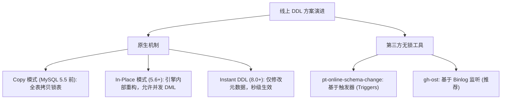
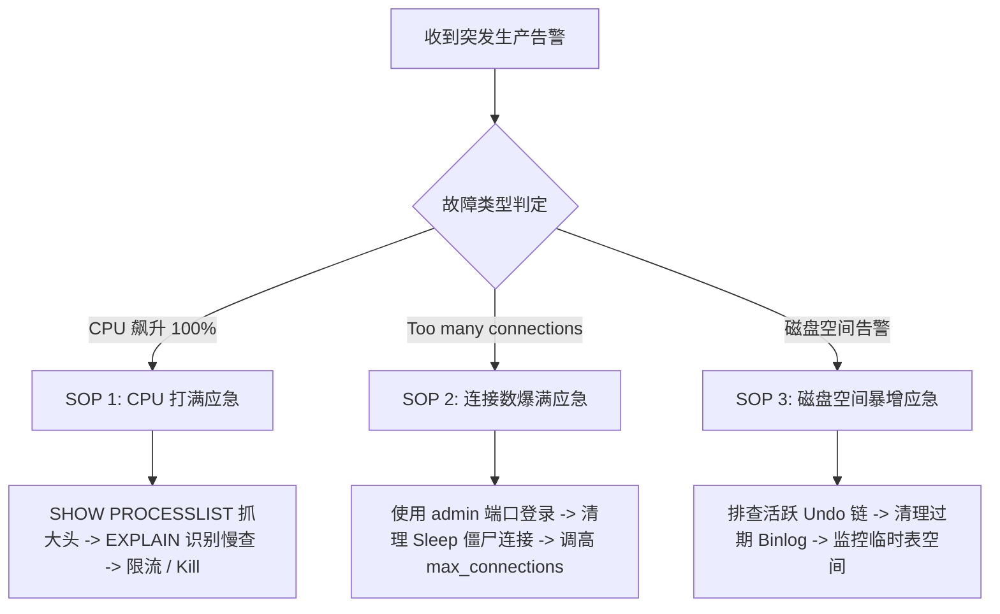

## MySQL 生产排障、无锁 DDL 与应急 SOP

在生产数据库的日常运维中，故障通常呈现出“高突发性、高危险性、不可逆性”的特征。掌握大表无锁 DDL 演进策略、深度读懂 InnoDB 运行状态指标、善用系统诊断视图，并具备标准化的故障应急 SOP，是高级 DBA 与架构师的必备底功。

---

## 一、 线上大表无锁 DDL 方案选型与演进

在线修改表结构（如增加字段、添加索引、修改字段类型）是导致线上生产事故的“重灾区”。一旦触发全表独占锁（Exclusive Lock）或 MDL 元数据锁排队，整个库的所有业务查询将瞬间被阻塞堆积，进而导致后端服务连接池打满崩溃。



### 1. 原生 Online DDL 演进历史

- **Copy 模式（早期 MySQL）**：
  新建临时表 $\to$ 锁原表（阻止一切读写） $\to$ 将原表全部记录拷贝到临时表 $\to$ 重命名临时表替换原表。期间原表完全不可写，数据量越大停服时间越长。
- **In-Place 模式（MySQL 5.6+ 引入）**：
  由存储引擎层在原表上直接进行物理重组，操作期间将增量业务写入记录到 Row Log 缓冲区中，DDL 结束时应用 Row Log。业务期间允许并发 DML 读写。
  - **局限**：在 DDL 开始和收尾提交的极短时刻，依然需要获取独占 MDL 锁；且修改列类型等操作依然会进行全量行重构，耗费大量磁盘 I/O。
- **Instant DDL（MySQL 8.0 引入）**：
  - **核心机理**：对于**在表尾新增列**（8.0.29+ 支持在任意位置增删列）、设置列默认值、重命名列等操作，**完全不需要重建表物理数据页，仅仅修改数据字典中的元数据信息**。
  - **耗时**：无论表数据量是 100 万还是 10 亿行，操作均在毫秒级内完成，从根本上消除了 DDL 导致的慢查询与锁风险。

### 2. 第三方工具横向对比：`gh-ost` vs `pt-online-schema-change`

在 MySQL 5.7 或执行必须重建表的复杂 DDL 时，第三方工具是生产首选方案：

| 评估维度 | `pt-online-schema-change`（Percona） | `gh-ost`（GitHub 开源） |
| :--- | :--- | :--- |
| **增量同步机制** | 在原表上创建 3 个触发器（`INSERT`/`UPDATE`/`DELETE`） | 伪装成从库，实时监听并解析主/从库的 **Binlog** 事件 |
| **对业务性能冲击** | 较高（触发器与业务事务处于同一个锁作用域，增大了死锁概率） | 极低（异步读取 Binlog，与主库业务事务完全解耦） |
| **负载限流与暂停** | 支持基于从库延迟指标限流，但无法真正完全暂停已触发逻辑 | 原生支持动态交互（可通过 Linux 命令随时暂停/恢复/调速） |
| **故障安全回滚** | 若异常中断，清理遗留的触发器与临时表较为复杂 | 直接断开连接，删除影子表即可，对原表零侵入与零副作用 |
| **生产选型推荐** | 传统稳定，兼容性广 | **生产强烈推荐**（目前主流大厂事实标准） |

---

## 二、 `SHOW ENGINE INNODB STATUS` 深度解密

当数据库发生响应变慢、死锁或线程挂起时，`SHOW ENGINE INNODB STATUS` 是提供信息量最丰富、最底层的诊断工具。

以下为生产中最核心的六大板块深度解读：

### 1. SEMAPHORES（信号量等待与底层互斥锁）

```text
----------
SEMAPHORES
----------
OS WAIT ARRAY INFO: reservation count 15204
--Thread 1402345678 has waited at btr0cur.cc line 560 for 24.00 seconds the semaphore:
Mutex at 0x7f8d68012340, registered at sync0sync.cc:1020, created at line 120
```

- **解析重点**：
  - 记录了 InnoDB 内部互斥量（Mutex）与读写锁（rw-locks）的竞争情况。
  - 如果出现 `has waited at ... for XX seconds`（等待超过 20 秒），说明发生了严重的底层代码锁等待或磁盘 I/O 僵死，极可能即将诱发 Long Semaphore Wait 导致 MySQL 实例被内核主动 Panic 重启。

### 2. TRANSACTIONS（事务状态与锁持有详情）

```text
------------
TRANSACTIONS
------------
Trx id counter 108520
Purge done for trx's n:o < 108450 undo n:o < 0 state: running
---TRANSACTION 108518, ACTIVE 120 sec fetching rows
mysql tables in use 1, locked 1
LOCK WAIT 3 lock struct(s), heap size 1136, 2 row lock(s)
MySQL thread id 45, OS thread handle 14023499, query id 8912 Sending data
SELECT * FROM orders WHERE user_id = 99 FOR UPDATE
```

- **解析重点**：
  - `Trx id counter` 与 `Purge done` 的差值代表尚未被后台清理的事务数量。差值过大说明存在长事务阻塞了 Undo Log 清理。
  - `ACTIVE XX sec`：事务持续活跃时长。若超过 60 秒需引起警惕。
  - `LOCK WAIT`：明确指明该事务正在被锁阻塞，其正在等待获取锁资源。

### 3. FILE I/O（磁盘 I/O 与异步 I/O 状态）

```text
--------
FILE I/O
--------
I/O sum[120]: ops[1200], bytes[19660800], read times[0.02s], write times[0.01s]
Pending normal aio reads: [0, 0, 0, 0] , aio writes: [0, 0, 0, 0]
Pending ibuf aio reads: 0, log i/o's: 0, sync i/o's: 0
```

- **解析重点**：
  - `Pending normal aio reads / writes`：挂起的异步 I/O 队列长度。若数值长期大于 0，说明磁盘物理硬件 I/O 已经达到极限瓶颈。
  - `read times / write times`：平均单次 I/O 耗时，正常 SSD 应低于 0.005 秒。

### 4. LOG（Redo Log 与 CheckPoint 进度）

```text
---
LOG
---
Log sequence number          10582049200
Log flushed up to            10582048500
Pages flushed up to          10580000000
Last checkpoint at           10578500000
```

- **核心指标数学推导**：
  - `Log sequence number (LSN)`：当前系统最新写入内存 Redo Log Buffer 的 LSN。
  - `Log flushed up to`：已经物理刷入磁盘 Redo 日志文件的 LSN。
  - `Last checkpoint at`：检查点推进到的 LSN。
  - **重要警报计算**：`LSN - Last checkpoint at` 代表**尚未通过脏页刷盘落盘的已写 Redo 日志总量**。若该差值逼近 Redo Log 文件的总容量上限（如达到 $75\%$），InnoDB 将强制暂停所有客户端事务写入，触发全系统卡顿（Sync Checkpoint 刷脏）。

### 5. BUFFER POOL AND MEMORY（缓冲池与脏页健康度）

```text
----------------------
BUFFER POOL AND MEMORY
----------------------
Buffer pool size        524288   # 总页数 (按 16KB 计算 = 8GB)
Free buffers            1024     # 空闲页数
Database pages          512000   # 缓存的数据页数
Modified db pages       15000    # 当前脏页数 (Dirty Pages)
Buffer pool hit rate    998 / 1000
```

- **健康度判定**：
  - 脏页率：`Modified db pages / Database pages`，通常维持在 $10\% \sim 50\%$ 之间属健康区间。
  - 缓存命中率（Hit Rate）：生产环境应当长期稳定在 $990 / 1000$（即 $99\%$）以上。若骤降至 $95\%$ 以下，说明存在全表扫描或内存严重不足。

---

## 三、 `Performance Schema` 与 `sys` 库排障实战

MySQL 官方内置的 `sys` 系统库将 `performance_schema` 复杂的底层追踪抽象为直观的视图，是生产定位性能瓶颈的利器。

### 1. 查找消耗 CPU/时间最多的 TOP 慢 SQL

```sql
SELECT 
    query, 
    exec_count, 
    total_latency, 
    avg_latency, 
    rows_sent_avg, 
    rows_examined_avg
FROM sys.statement_analysis
ORDER BY total_latency DESC
LIMIT 10;
```

### 2. 快速排查行锁/死锁阻塞源头与等待链路

当业务报超时错误时，执行该查询能瞬间找出“谁在阻塞谁”：

```sql
SELECT 
    waiting_trx_id,
    waiting_pid,
    waiting_query,
    blocking_trx_id,
    blocking_pid,
    blocking_query,
    wait_age,
    sql_kill_blocking_query
FROM sys.innodb_lock_waits;
```

- 视图中直接提供了 `sql_kill_blocking_query` 字段，必要时复制该列内容（如 `KILL 892;`）可瞬间终止罪魁祸首事务。

### 3. 查询全表扫描（Full Table Scan）次数最多的表

```sql
SELECT 
    table_schema, 
    table_name, 
    rows_full_scanned, 
    latency
FROM sys.schema_tables_with_full_table_scans
WHERE table_schema NOT IN ('sys', 'mysql', 'performance_schema')
ORDER BY rows_full_scanned DESC
LIMIT 10;
```

---

## 四、 生产突发故障排查 SOP

面对突发生产告警，严禁慌乱试探，必须严格按照 SOP 逐层收敛排查。



### 1. SOP 1：CPU 飙升至 100% 应急处置

1. **第一步：抓取活跃连接与当前运行语句**

   ```sql
   -- 过滤掉 Sleep 的空闲连接，按执行耗时倒序排列
   SELECT id, user, host, db, command, time, state, info 
   FROM information_schema.processlist 
   WHERE command != 'Sleep' 
   ORDER BY time DESC 
   LIMIT 20;
   ```

2. **第二步：研判慢 SQL 特征**
   - 若大量出现相同模板的慢 SQL（如多表 Join 未走索引或模糊全表扫描），记录其 `query`。
   - 对慢 SQL 执行 `EXPLAIN`，确认是否命中 `type=ALL`。
3. **第三步：止血干预**
   - 通过 `KILL <id>` 杀掉执行时间过长的查询语句，让 CPU 迅速回落。
   - 在应用网关层（API Gateway）对该接口实施临时降级或限流，防止前端持续打入打爆实例。

### 2. SOP 2：Too many connections 连接池打满应急处置

当外部连接被打满时，普通开发人员连数据库都无法连接，报 `ERROR 1040 (HY000): Too many connections`。

1. **第一步：使用专属管理端口接入**
   - MySQL 8.0 默认提供了 `admin_port`（默认 33062）和管理监听地址 `admin_address`。该端口专为具备 `SERVICE_CONNECTION_ADMIN` 权限的 DBA 保留专属连接通道，即使主端口连接打满，管理端口依然可以随时登入：

     ```bash
     mysql -h 127.0.0.1 -P 33062 -u root -p
     ```

2. **第二步：清理积压的空闲或阻塞连接**

   ```sql
   -- 查看连接来源与状态分布
   SELECT user, host, command, COUNT(*) 
   FROM information_schema.processlist 
   GROUP BY user, host, command;
   ```

   - 若发现大量应用节点保持着成百上千个空闲 `Sleep` 状态连接，可编写临时脚本批量 `KILL` 空闲超过 300 秒的连接。
3. **第三步：动态临时扩大连接数上限**

   ```sql
   SET GLOBAL max_connections = 2000;
   ```

### 3. SOP 3：磁盘空间突增暴涨应急处置

1. **排查三大磁盘吞噬源**：
   - **Binlog 堆积**：检查从库同步状态。若从库中断或主库未配置自动过期，导致 Binlog 迅速占满磁盘。通过安全命令清理：

     ```sql
     PURGE BINARY LOGS BEFORE NOW() - INTERVAL 3 DAY;
     ```

   - **Undo Log 膨胀**：检查是否存在多天前开启却未提交的失控长事务。杀掉该连接事务后，后台 Purge 线程会自动回收空间。
   - **磁盘内部临时表打满（`ibtmp1`）**：复杂 `GROUP BY` 或 `UNION` 没有索引，生成了上百 GB 的磁盘临时表。终止相应查询后，临时表空间将释放。
