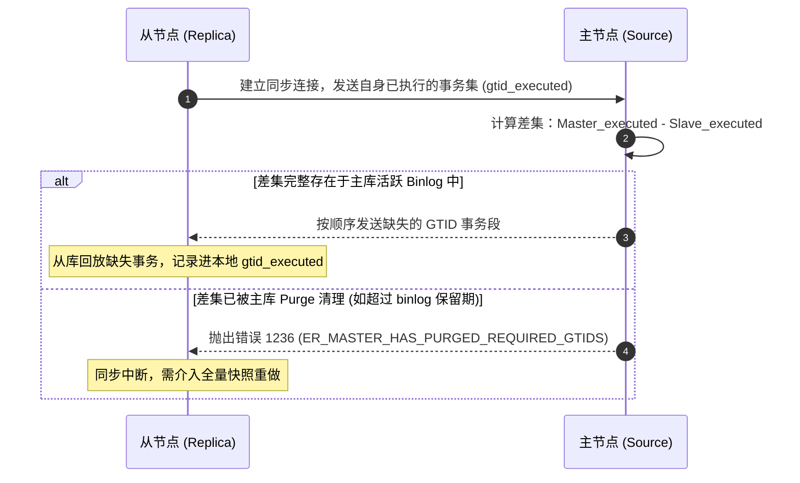
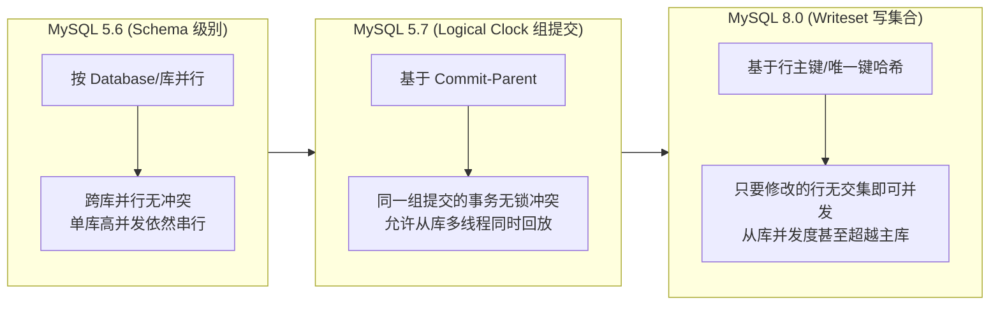
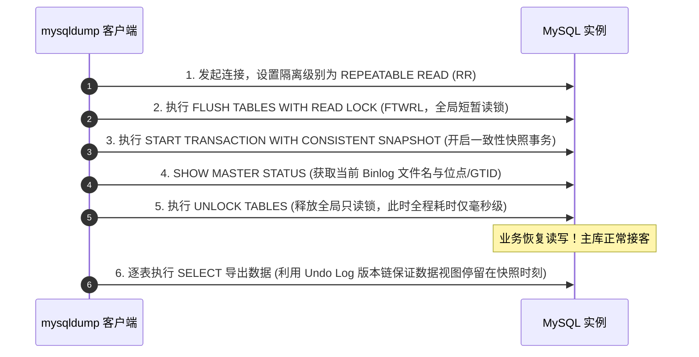
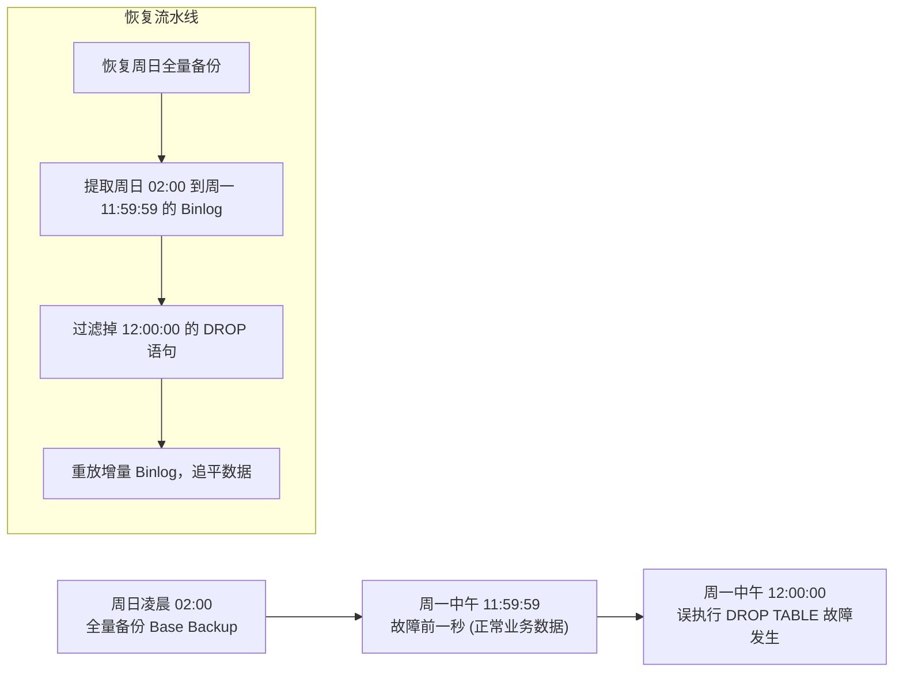

## MySQL 灾备恢复、GTID 复制与高可用架构

高可用（High Availability, HA）与灾难恢复（Disaster Recovery, DR）是生产级数据库运维的底线保障。数据复制是构建高可用集群的技术底座，而完备的备份恢复与自动故障转移机制则是防止数据丢失与业务瘫痪的关键防线。

---

## 一、 GTID 复制机制与主从切换

在传统 MySQL 复制中，从库依赖主库的 `binlog_file_name` 和 `binlog_position`（二进制日志文件名和偏移量位点）来定位同步点。在大规模集群和级联复制中，位点维护容易出错，主从故障切换难度极大。MySQL 5.6 引入、并在 5.7/8.0 成为标准的 **GTID（Global Transaction Identifier，全局事务标识符）** 彻底改变了这一现状。

### 1. GTID 的构成与生命周期

一个 GTID 代表一个在主库上提交的全局唯一事务，其标准格式为：

```text
GTID = source_id:transaction_id
```

- **`source_id`**：发起该事务的原生节点的唯一 UUID（即 `server_uuid`）。
- **`transaction_id`**：一个在该节点上严格自增的 64 位整数（也称 GNO, Group Number），从 1 开始递增。
- **示例**：`3E11FA47-71CA-11E1-9E33-C80AA9429562:1-5` 表示源节点连续提交的第 1 到第 5 个全局事务。

### 2. GTID 自动定位（Auto-Positioning）原理

开启 GTID 复制后，从库连接主库无需手动指定文件偏移量，只需声明：

```sql
CHANGE MASTER TO 
    MASTER_HOST='192.168.1.10',
    MASTER_PORT=3306,
    MASTER_USER='repl',
    MASTER_PASSWORD='ReplPassword123!',
    MASTER_AUTO_POSITION=1;
```



### 3. GTID 相比传统位点复制的核心优势

- **主从故障转移极度简化**：当主库宕机时，新主库选举完毕后，其他所有从库直接将 `MASTER_HOST` 指向新主并开启 `MASTER_AUTO_POSITION=1`，MySQL 会自动比对并补齐差集事务，彻底消除人工计算位点的失误。
- **幂等性与防止重复执行**：若从库的 `gtid_executed` 集合中已经包含某 GTID，无论 Binlog 重放多少次，从库都会自动跳过该事务，从根本上防止事务重复回放导致的主键冲突或脏数据。

---

## 二、 从库多线程并行复制演进

传统主从复制最大的痛点是**主从延迟（Replication Lag）**。其本质根因在于：**主库是高并发多线程并行写入，而早期从库仅有一个 SQL Thread 单线程串行回放 Binlog**。随着吞吐量上升，从库积压势不可挡。

MySQL 经历三个阶段的架构重构，彻底突破了单线程瓶颈：



### 1. MySQL 5.6：基于库级别的并行复制

- **原理**：为每个数据库（Schema）分配一个独立的 Worker 线程回放事务。
- **局限**：大部分现代微服务业务库均为单库（Single Database），所有的表都在同一个库内，导致依然退化为单线程 Worker，无法解决实际业务延迟。

### 2. MySQL 5.7：基于 Group Commit（Logical Clock）的并行复制

- **原理**：主库执行阶段，如果多个事务能够被纳入同一个 **Group Commit（组提交）** 进行刷盘，说明这些事务在锁阶段互不冲突、没有并发写冲突。
- **核心标识**：在 Binlog 中记录两个逻辑时钟字段：
  - `last_committed`：上一个已经提交事务的序号（Commit Parent）。
  - `sequence_number`：当前事务的递增编号。
- **从库策略**：从库检查只要多个事务的 `last_committed` 相同，就代表它们在主库是并发执行的，Worker 线程池可以同时并发回放这批事务。

### 3. MySQL 8.0：基于 Writeset（写集合）的极致并行复制

- **原理**：不局限于事务是否属于同一个组提交，而是更底层地去追踪事务实际修改了哪些行。
- **机制**：
  - 主库利用每行数据的主键或唯一键计算一个 64 位的哈希值（Writeset）。
  - 维护一个全局 Writeset 历史追踪表。如果事务 B 修改的行哈希值与正在执行的事务 A 没有重叠，即使事务 B 较晚发起，也可以安全地与事务 A 并发执行。
- **生产配置**：

  ```ini
  # 主库开启 Writeset 追踪
  binlog_transaction_dependency_tracking = WRITESET
  transaction_write_set_extraction = XXHASH64
  
  # 从库开启多线程并行回放
  slave_parallel_type = LOGICAL_CLOCK
  slave_parallel_workers = 16
  slave_preserve_commit_order = ON
  ```

---

## 三、 备份与容灾机制

备份是保障数据安全不丢失的最后底线。在发生误删库（如 `DROP TABLE`）、勒索软件攻击或物理存储损坏时，备份体系决定了企业的存亡。

### 1. 逻辑备份 vs 物理备份横向对比

| 对比维度 | 逻辑备份（mysqldump / mydumper） | 物理备份（Percona XtraBackup / MEB） |
| :--- | :--- | :--- |
| **备份原理** | 通过客户端协议执行 `SELECT` 导出建表与 `INSERT` SQL 文本 | 直接拷贝底层物理文件（`.ibd`、页数据、Redo Log 块） |
| **备份速度** | 较慢（受限于 CPU 序列化与网络传输），适用于 50GB 以下 | 极快（直接顺序读写磁盘块），TB 级库标配 |
| **恢复速度** | 极慢（需要重新执行建表、插入、构建 B+ 树索引与重做日志） | 极快（应用 Redo 日志追平后直接挂载启动服务） |
| **锁表影响** | 配合 `--single-transaction` 可实现 InnoDB 无锁备份 | 无锁备份（基于 LSN 持续追随 Redo 日志） |
| **灵活性** | 高（可直接文本编辑 SQL、支持跨操作系统/版本迁移） | 低（必须相同大版本、相同操作系统架构） |

### 2. `mysqldump` 的 `--single-transaction` 运行机理

很多工程师疑惑：为什么执行 `mysqldump --single-transaction --master-data=2` 可以在备份百万行大表时**完全不阻塞业务的读写操作**？



> [!WARNING]
> `--single-transaction` 仅对 **InnoDB 表** 生效。若库内混杂 MyISAM 表，导出过程中针对 MyISAM 依然会施加全局锁或者导致导出的 MyISAM 数据不一致。

---

## 四、 基于 PITR（时间点恢复）的生产实操全流程

生产环境最常见的灾难是**误操作（如开发人员写错 `WHERE` 条件执行了清表操作）**。时间点恢复（Point-in-Time Recovery, PITR）的核心思路是：**全量物理/逻辑备份 + Binlog 增量重放到故障发生的前一秒**。



### 1. 步骤一：恢复最近一次全量备份

在临时应急实例上解压并恢复基准物理备份（以 XtraBackup 为例）：

```bash
# 准备物理备份 (Prepare 阶段应用 Redo 日志保证 Crash-Safe 一致)
xtrabackup --prepare --target-dir=/data/backup/base_20261101

# 将备份数据恢复到新实例数据目录
xtrabackup --copy-back --target-dir=/data/backup/base_20261101 --datadir=/var/lib/mysql_recovery
chown -R mysql:mysql /var/lib/mysql_recovery
```

### 2. 步骤二：从 Binlog 中定位故障事务与安全位点

通过 `mysqlbinlog` 工具分析误操作发生前后的事务：

```bash
# 搜索误操作语句所在的位置
mysqlbinlog --no-defaults -v --base64-output=DECODE-ROWS \
    /var/log/mysql/binlog.000120 | grep -B 5 -A 10 "DROP TABLE"
```

假设输出确定误操作发生的时间点为 `2026-11-02 12:00:00`，停止位点为 `stop-position=458921`。

### 3. 步骤三：导出并重放增量 Binlog

从全量备份记录的位点（或 GTID）开始，导出截止到误操作之前的纯净 SQL：

```bash
# 按时间点精准截取 Binlog 并导入应急实例
mysqlbinlog --no-defaults \
    --start-datetime="2026-11-01 02:00:00" \
    --stop-datetime="2026-11-02 11:59:59" \
    /var/log/mysql/binlog.000118 \
    /var/log/mysql/binlog.000119 \
    /var/log/mysql/binlog.000120 | mysql -u root -p -S /var/run/mysqld/mysql_recovery.sock
```

验证表数据完整无误后，将受损表导回生产库或执行实例流量切流。

---

## 五、 主流开源高可用架构全景对比

生产环境要求数据库具备 $99.99\%$ 以上的高可用性，当主库硬件故障或机房断电时，系统必须自动完成主从选举与流量漂移。

### 1. 核心高可用方案横向对比

| 方案 | 核心选主机制 | 脑裂防范机制 | 数据一致性能力 | 部署与运维复杂度 | 生产应用画像 |
| :--- | :--- | :--- | :--- | :--- | :--- |
| **MHA (Master High Availability)** | 外部 Perl 脚本监控检测，SSH 登录从库比较 LSN 选主 | 依赖自定义二次脚本（如 Power Off 物理电源隔离） | 异步/半同步复制，主崩时尝试远程拉取残留 Binlog 补偿 | 需打通节点间 SSH 免密信任，脚本维护成本高 | 互联网早期主流，目前已逐步进入归档/维护期 |
| **Orchestrator** | 外部 Raft 集群通过协议定期拉取拓扑，全局视角裁决 | 内置 HTTP/Raft 仲裁机制，避免单点误判 | 支持 GTID + 伪 GTID，自动重构级联复制拓扑 | 独立部署服务，具备现代 Web UI 与丰富 REST API | 当前互联网大厂与云原生架构的事实标准拓扑管理利器 |
| **MGR / InnoDB Cluster** | 原生 Paxos 变体（GCS 组通信系统）协议内核自治 | 多数派法定票数（Quorum），少数派自动分区降级只读 | 强一致事务同步，认证阶段（Certify）冲突回滚 | 原生官方方案，需统一网络环境，对长事务与大事务敏感 | 官方主推方案，适用于纯金融/交易强一致场景 |

```mermaid
graph TD
    subgraph HA_Eco ["MySQL 高可用两大主流流派"]
        subgraph External ["流派 A：外部集中式拓扑仲裁 (Orchestrator)"]
            O1["Orchestrator Raft 节点 1"] --- O2["Orchestrator Raft 节点 2"] --- O3["Orchestrator Raft 节点 3"]
            O2 -.->|主动探测拓扑| NodeA["MySQL 主节点"]
            O2 -.->|主动探测拓扑| NodeB["MySQL 从节点 1"]
            O2 -.->|主动探测拓扑| NodeC["MySQL 从节点 2"]
        end

        subgraph Internal ["流派 B：内核分布式共识组复制 (MGR / InnoDB Cluster)"]
            M1["MySQL 节点 1 (Primary)"] <===>|Paxos 组通信协议| M2["MySQL 节点 2 (Secondary)"]
            M2 <===>|Paxos 组通信协议| M3["MySQL 节点 3 (Secondary)"]
        end
    end
```



### 2. 高可用选型决策建议

- **传统大规模微服务、分库分表海量拓扑**：首选 **Orchestrator + VIP/ProxySQL/Consul**。Orchestrator 只做拓扑发现与决策，不直接侵入数据库内核通信，对长事务兼容性好，主从拓扑可视化与自动化修复能力极强。
- **核心金融、资产账户记账、轻量关键业务**：首选 **官方 InnoDB Cluster（MGR + MySQL Router）**。具备官方端到端原生支持，事务无需担心丢失，节点状态由内核 Paxos 自动裁决，免去外部第三方的部署与版本冲突。
