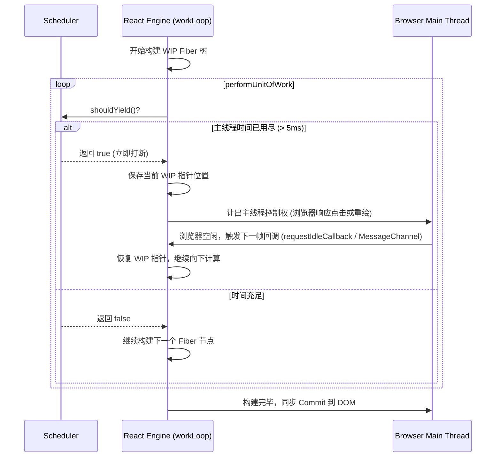

# 并发模式与时间切片

并发模式（Concurrent Mode）是现代 React（React 18 / 19）最底层的运行架构。它颠覆了原本“一旦开始、必须同步完成”的渲染模式，让 React 能够“在多项任务之间切换调度”，并根据任务优先级来中断或恢复页面的更新，从而为用户提供极其流畅的交互体验。

---

## 1. 并发模式的设计初衷

在传统的同步更新模式下，如果执行了一个计算量极其庞大的页面重渲染：
- 渲染线程一旦启动就会霸占主线程，直到所有组件渲染完毕。
- 用户在此期间的所有点击、滚动、输入事件都会被挂起排队，导致浏览器出现几百毫秒甚至数秒的卡顿假死。

并发模式的核心目标是**解决 CPU 瓶颈与 I/O 瓶颈**。它的核心策略是：
1. **时间切片 (Time Slicing)**：将单一长渲染任务切碎为多帧微型子任务。
2. **优先级调度 (Priority-based Scheduling)**：根据任务的紧急程度决定谁先执行，且高优先级的任务可以打断正在执行的低优先级任务。

---

## 2. 优先级标尺：Lane 模型 (The Lane Model)

在 React 16 中，任务优先级采用的是 **ExpirationTime（过期时间）** 模型，数值越小代表优先级越高。但这一模型无法直观地表达“任务批处理、任务组合”的场景。

React 17 起全面引入了 **Lane 模型**。Lane 意为“车道”，React 使用了一个 **32 位二进制的整型数（Bitmask）** 来代表任务的优先级和类别。

### Lane 优先级位图划分（简化版）

每个“车道”都是二进制中的一位（1 bit）：

```typescript
// 💡 Lane 优先级位图常量定义
export const NoLanes: Lanes =             0b0000000000000000000000000000000;
export const SyncLane: Lane =             0b0000000000000000000000000000001; // 同步车道（如输入框即时反馈、flushSync）
export const InputContinuousLane: Lane =  0b0000000000000000000000000000010; // 连续输入车道（如滚动、拖拽）
export const DefaultLane: Lane =          0b0000000000000000000000000010000; // 默认车道（如普通的 setState 状态修改）
export const TransitionLane: Lane =       0b0000000000000000000000001000000; // 转换车道（如 startTransition、useDeferredValue）
export const OffscreenLane: Lane =        0b1000000000000000000000000000000; // 后台/离屏车道（如隐藏的 Tab 预加载）
```

### Lane 模型的位运算应用

因为使用了二进制表示，React 可以极其快速、轻量地通过 **位运算** 来合并、剥离或筛选出高优先级的任务车道：

```javascript
// 1. 合并两个车道的任务（位或操作）
const mergedLanes = laneA | laneB;

// 2. 判断某个车道是否在待处理集合中（位与操作）
const isLaneContained = (mergedLanes & SyncLane) !== 0;

// 3. 提取出当前最高优先级的单个车道（获取二进制中最低位的 1：lanes & -lanes）
const highestPriorityLane = mergedLanes & -mergedLanes;
```

### 饥饿问题与车道过期机制 (Lane Starvation & Expiration)

如果用户持续不断地快速打字输入，系统不断产生高优先级的 `SyncLane` 任务，处于低优先级的 `TransitionLane` 是否会被无限期延后、永远无法渲染？

答案是**不会**。React 调度系统为每个 Lane 设置了过期时间戳（例如普通过渡任务的过期阈值约为 5000ms）。
当低优先级任务在队列中等待超时后，Scheduler 会触发**任务饥饿补偿机制**，将该任务的车道标记直接强制提升为 `SyncLane`，强行插队同步执行，避免页面状态长期僵死。

---

## 3. 并发更新中断与恢复流程 (Reconciliation Interruption)

并发模式的核心奥秘在于 `workLoopConcurrent` 循环。当 React 渲染一个组件时，会调用 Scheduler（调度器）来判断是否需要把主线程控制权归还给浏览器。



### 并发任务打断的完整场景

1. **低优先级渲染启动**：用户点击“加载更多商品”，触发 `DefaultLane` 更新。React 启动 `workLoopConcurrent` 在内存中慢慢计算。
2. **紧急任务突袭**：计算到一半时，用户在搜索框里输入了一个字母，触发 `SyncLane` 更新。
3. **调度器决策**：Scheduler 检测到有高优先级的 `SyncLane` 挂起，且 `SyncLane < DefaultLane`（优先级高于默认车道），立刻强行打断当前 WIP 树的计算。
4. **优先处理紧急任务**：React 丢弃或挂起刚才计算到一半的低优先级 WIP 树，重新以最新输入值构建一棵全新的 `SyncLane` WIP 树，并以最快速度 Commit 到真实 DOM，呈现用户的输入反馈。
5. **恢复低优先级任务**：紧急任务渲染完毕后，Scheduler 在下一次空闲时间里，重新安排并恢复低优先级 `DefaultLane` 任务的计算。

---

## 4. 并发 API：useTransition / startTransition 与 useDeferredValue

并发模式的底层原理为我们提供了几个可以显著提升页面流畅度的 API：

### 1) startTransition 与 useTransition 的应用与原理解析

在 React 18+ 中，非紧急更新的过渡任务可以通过两种方式开启：
- **`startTransition` 函数**：直接导入的独立函数。当你在非 React 组件树内部（例如在第三方状态管理器订阅中，或普通的 utility 函数里）想要触发过渡更新时使用。
- **`useTransition` Hook**：在 React 函数组件内使用的首选 Hook，它不仅包含 `startTransition`，还能够智能返回过渡任务的执行状态。

#### 💡 核心示例：React 19 异步 Transition (Async Transitions)

> [!IMPORTANT]
> **React 19 重磅改进**：在 React 18 中，`startTransition` 仅支持同步的状态更新回调。而在 **React 19** 中，`startTransition` 正式原生支持 **异步函数 (Async Function)**！
> 当你在回调中执行 `await apiCall()` 时，`isPending` 会在整个异步网络等待与状态更新期间持续保持为 `true`，大大简化了异步加载态管理。

```tsx
import { useState, useTransition } from 'react';

export function UserProfileEditor() {
  const [name, setName] = useState('张三');
  const [isPending, startTransition] = useTransition();

  const handleSave = () => {
    // React 19 原生支持异步 Transition
    startTransition(async () => {
      // 1. 发起真实服务端保存请求
      const updatedUser = await fetch('/api/user', {
        method: 'POST',
        body: JSON.stringify({ name }),
      }).then((r) => r.json());

      // 2. 更新状态
      setName(updatedUser.name);
    });
  };

  return (
    <div>
      <input value={name} onChange={(e) => setName(e.target.value)} />
      <button onClick={handleSave} disabled={isPending}>
        {isPending ? '保存并同步中...' : '保存修改'}
      </button>
    </div>
  );
}
```

### 2) useDeferredValue 的应用与 initialValue

`useDeferredValue` 接受一个值，并返回该值的一个“延迟版本”。它非常适用于：你无法直接控制状态修改的来源（如数据直接来自于 Props），但依然希望推迟其渲染以防页面假死的场景。

在 **React 19** 中，`useDeferredValue` 新增了第二个参数 `initialValue`：

```tsx
import { useState, useDeferredValue } from 'react';

function SearchResults({ query }: { query: string }) {
  // React 19 新特性：支持传递 initialValue，在首屏挂载阶段使用该初始值，推迟昂贵渲染
  const deferredQuery = useDeferredValue(query, '');

  return (
    <div className="results-container">
      <p>搜索目标：{deferredQuery}</p>
      {/* 模拟大列表渲染 */}
      <HeavyList query={deferredQuery} />
    </div>
  );
}
```

---

## 5. useTransition 与防抖 (Debounce) 的深度对比

很多开发者容易混淆 `useTransition` 与传统防抖函数（`debounce`）的应用边界。下表对比了两者的本质区别与选型策略：

| 维度 | 传统防抖 (Debounce) | 并发过渡 (useTransition) |
| :--- | :--- | :--- |
| **核心机制** | 强制延迟固定毫秒数（如 300ms），时间未到坚决不执行 | **自适应设备算力**：高算力机器几乎零延迟瞬间完成，低端设备自动按帧让出主线程 |
| **用户体验** | 在高性能电脑上依然存在机械式的 300ms 迟滞感 | 随时响应输入，输入停下即刻渲染，无任何人为延时 |
| **可中断性** | 无法中断；一旦定时器到期触发渲染，依然可能卡死主线程 | **完全可中断**；渲染进行到 50% 时若有新输入，立刻放弃并重新开始 |
| **网络请求控制** | 适用于控制向后端 API 发送请求的频次（避免高频刷接口） | 适用于解决客户端复杂组件树大计算量的渲染卡顿 |
| **最佳实践** | 搜索输入建议请求用 Debounce | 纯前端过滤、Tab 大页面切换、复杂图表重绘首选 `useTransition` |

