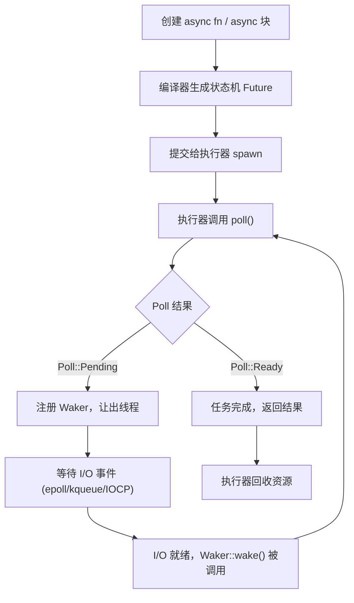

# Async/Await 异步编程

现代软件系统中，网络请求、磁盘读写、数据库查询等 I/O 操作往往占据程序运行时间的绝大部分。如果每次等待 I/O 完成都阻塞一个操作系统线程，程序的吞吐量将受到严重制约——创建线程本身需要消耗内存（默认栈大小约 2–8 MB），线程切换也有不可忽视的上下文切换开销。

Rust 的异步编程模型提供了一种在单个（或少量）线程上并发处理数以万计 I/O 任务的能力，同时保留了 Rust 一贯的零成本抽象与内存安全保证。

## 为什么需要异步编程

考虑一个典型的 Web 服务器场景：服务器同时处理 10,000 个客户端连接，每个连接在等待数据库查询结果时都处于空闲状态。若用同步线程模型，需要维护 10,000 个线程，内存开销高达数十 GB。而异步模型只需少量线程，通过在任务等待 I/O 时切换执行其他任务，极大提升资源利用率。

**适合使用异步的场景：**

- 高并发网络服务（HTTP、gRPC、WebSocket）
- 同时发出多个 HTTP 请求并等待结果
- 文件系统或数据库的批量 I/O 操作
- 实时消息处理管道

**不适合使用异步的场景：**

- CPU 密集型计算（应使用多线程或 Rayon）
- 简单的脚本工具（同步代码更直观）

## Rust 异步模型的三大核心概念

### Future

`Future` 是 Rust 异步编程的基础 trait，代表一个尚未完成的计算。它类似于其他语言中的 Promise 或 Task，但有一个关键区别：**Rust 的 Future 是惰性的**——只有被执行器（Executor）主动轮询（poll）时才会推进执行。

### async/await 语法

`async fn` 和 `.await` 是 Rust 提供的语法糖，让异步代码看起来与同步代码几乎一样，消除了"回调地狱"。编译器会将 `async fn` 自动转换为返回 `impl Future` 的普通函数。

### 执行器（Executor）

执行器负责驱动 Future 运行。Rust 标准库不内置执行器，而是由第三方库提供，最主流的是 [Tokio](https://tokio.rs)。执行器维护一个任务队列，不断轮询 Future 直到其完成。

## 与其他并发模型的对比

| 特性 | Rust async/await | OS 线程 | Go goroutine | JS Promise |
|---|---|---|---|---|
| 内存开销 | 极低（Future 大小由编译器决定） | 高（MB 级栈） | 低（KB 级，可增长） | 中等 |
| 调度方式 | 协作式（用户态） | 抢占式（内核） | 抢占式（运行时） | 协作式（事件循环） |
| 安全性 | 编译期保证内存安全 | 需手动同步 | GC 保证 | 动态类型，运行时错误 |
| 生态成熟度 | 成熟（Tokio 生态） | 成熟 | 内置 | 内置 |
| 零成本抽象 | ✅ | ✅ | ❌（运行时开销） | ❌（GC 开销） |
| 适合嵌入式 | ✅（embassy） | 有限 | ❌ | ❌ |

## 本章学习路线图

本章按照从语法到原理、从使用到定制的顺序，系统介绍 Rust 异步编程体系：

1. **[Future 与 async/await 语法](ch21-01-futures-and-syntax.md)**：掌握基础语法，理解 `.await` 的本质
2. **[async 并发模式](ch21-02-concurrency-with-async.md)**：`join!`、`select!`、`spawn` 实现真正的并发
3. **[深入 Future：Pin 与 Unpin](ch21-03-more-futures.md)**：理解自引用结构体与内存固定机制
4. **[异步流：Stream](ch21-04-streams.md)**：处理异步数据序列
5. **[Future 内部原理：状态机与 Waker](ch21-05-future-internals.md)**：理解状态机、轮询与唤醒协议
6. **[Trait 中的异步方法](ch21-06-async-traits.md)**：比较静态分发与 trait object 的异步接口
7. **[异步运行时选择](ch21-07-runtimes.md)**：根据目标平台、生态和运行约束选择运行时
8. **[异步工程实践](ch21-08-async-engineering.md)**：处理取消、背压、阻塞任务、关闭与异步测试

## async 任务生命周期

下图展示一个异步任务从创建到完成的完整生命周期：



## 快速起步

在开始学习之前，确保 `Cargo.toml` 中添加了 Tokio 依赖：

```toml
[dependencies]
tokio = { version = "1", features = ["full"] }
```

最简单的异步程序如下：

```rust
#[tokio::main]
async fn main() {
    println!("Hello from async Rust!");
    let result = fetch_data().await;
    println!("获取到数据：{}", result);
}

async fn fetch_data() -> String {
    // 模拟异步操作
    tokio::time::sleep(tokio::time::Duration::from_millis(100)).await;
    String::from("异步数据")
}
```

`#[tokio::main]` 宏自动创建 Tokio 运行时并将 `async main` 函数包裹其中，这是大多数 Tokio 程序的标准入口形式。

接下来，让我们从基础语法开始深入学习。
