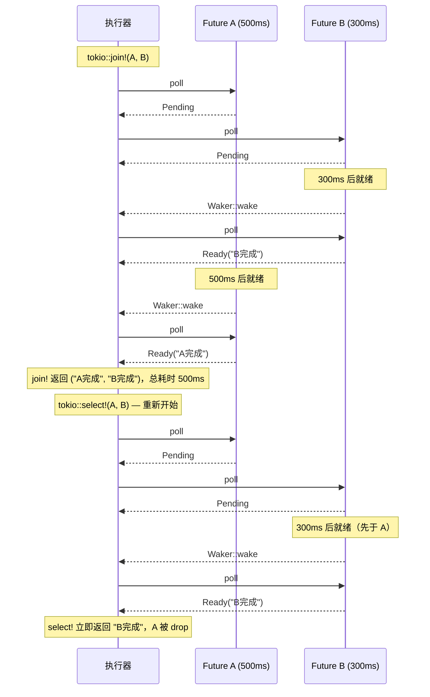

# async 并发模式

在上一节中，我们学习了 `async/await` 的基本语法。但仅仅顺序地 `.await` 多个 Future，并不能发挥异步编程的真正威力——任务仍然是一个接一个执行的。本节介绍如何在 async 代码中实现真正的**并发**（concurrent）执行。

## 顺序执行 vs 并发执行

假设有两个异步任务，各耗时 500ms：

```rust
use tokio::time::{sleep, Duration};

async fn task_a() -> &'static str {
    sleep(Duration::from_millis(500)).await;
    "任务 A 完成"
}

async fn task_b() -> &'static str {
    sleep(Duration::from_millis(500)).await;
    "任务 B 完成"
}

// ── 顺序执行：总耗时约 1000ms ──────────────────────────
async fn sequential() {
    let a = task_a().await;
    let b = task_b().await;
    println!("{}, {}", a, b);
}

// ── 并发执行：总耗时约 500ms ───────────────────────────
async fn concurrent() {
    let (a, b) = tokio::join!(task_a(), task_b());
    println!("{}, {}", a, b);
}
```

**顺序执行**时，B 必须等待 A 完成后才开始；**并发执行**时，A 和 B 同时在同一线程上交替推进（通过 `.await` 点切换），总耗时接近单个任务的时间。

> **注意**：并发（concurrent）≠ 并行（parallel）。`tokio::join!` 在单线程上并发执行，而 `tokio::spawn` 可以利用多线程实现并行。

## tokio::join! 宏

`tokio::join!` 同时驱动多个 Future，**所有 Future 都完成后**才返回，返回值是各 Future 结果组成的元组：

```rust
use tokio::fs;

async fn load_config() -> String {
    fs::read_to_string("config.toml").await.unwrap_or_default()
}

async fn load_secrets() -> String {
    fs::read_to_string("secrets.env").await.unwrap_or_default()
}

async fn load_schema() -> String {
    fs::read_to_string("schema.sql").await.unwrap_or_default()
}

#[tokio::main]
async fn main() {
    // 三个文件同时读取，总耗时 ≈ 最慢那个文件的读取时间
    let (config, secrets, schema) = tokio::join!(
        load_config(),
        load_secrets(),
        load_schema()
    );

    println!("配置长度：{}", config.len());
    println!("密钥长度：{}", secrets.len());
    println!("Schema 长度：{}", schema.len());
}
```

`join!` 的特点：

- 在当前任务内部并发，不创建新线程或新 Task
- 任何一个 Future 返回错误不会中止其他 Future（需自行处理错误）
- 适合数量**固定**、在编译期已知的 Future 组合

## tokio::select! 宏

`select!` 同时等待多个 Future，**哪个最先完成就处理哪个**，其余 Future 被取消（drop）：

```rust
use tokio::time::{sleep, Duration};
use tokio::sync::oneshot;

#[tokio::main]
async fn main() {
    let (tx, rx) = oneshot::channel::<String>();

    tokio::spawn(async move {
        sleep(Duration::from_millis(300)).await;
        let _ = tx.send(String::from("来自通道的消息"));
    });

    tokio::select! {
        msg = rx => {
            println!("收到消息：{:?}", msg);
        }
        _ = sleep(Duration::from_millis(1000)) => {
            println!("超时！");
        }
    }
}
```

### select! 实现超时控制

`select!` 最常见的用途之一是为异步操作添加超时：

```rust
use tokio::time::{timeout, Duration};

async fn fetch_with_timeout(url: &str) -> Result<String, &'static str> {
    tokio::select! {
        result = slow_fetch(url) => {
            result.map_err(|_| "请求失败")
        }
        _ = tokio::time::sleep(Duration::from_secs(5)) => {
            Err("请求超时")
        }
    }
}

async fn slow_fetch(_url: &str) -> Result<String, ()> {
    tokio::time::sleep(Duration::from_secs(10)).await;
    Ok(String::from("响应内容"))
}
```

更简洁地，Tokio 提供了 `tokio::time::timeout` 包装器：

```rust
match timeout(Duration::from_secs(5), slow_fetch("http://example.com")).await {
    Ok(Ok(body)) => println!("成功：{}", body),
    Ok(Err(_))   => println!("请求错误"),
    Err(_)       => println!("超时"),
}
```

### select! 的注意事项

```rust
// ⚠️ select! 中的 Future 必须是幂等的（Fused），
// 或者使用 biased 属性避免随机公平选择带来的问题

use futures::FutureExt;

async fn careful_select() {
    let mut fut1 = task_a().fuse();
    let mut fut2 = task_b().fuse();

    futures::select! {
        result = fut1 => println!("fut1 先完成：{}", result),
        result = fut2 => println!("fut2 先完成：{}", result),
    }
}
```

## futures::future::join_all：动态数量的 Future

当 Future 数量在运行时才确定时，使用 `join_all`：

```rust
use futures::future::join_all;
use reqwest::Client;

async fn fetch_all(urls: Vec<&str>) -> Vec<Result<String, reqwest::Error>> {
    let client = Client::new();

    // 为每个 URL 创建一个 Future
    let futures: Vec<_> = urls
        .iter()
        .map(|url| {
            let client = client.clone();
            let url = url.to_string();
            async move {
                client.get(&url).send().await?.text().await
            }
        })
        .collect();

    // 并发等待所有 Future 完成
    join_all(futures).await
}

#[tokio::main]
async fn main() {
    let urls = vec![
        "https://httpbin.org/get",
        "https://httpbin.org/ip",
        "https://httpbin.org/uuid",
    ];

    let results = fetch_all(urls).await;
    for (i, result) in results.iter().enumerate() {
        match result {
            Ok(body) => println!("URL {}: {} 字节", i, body.len()),
            Err(e)   => println!("URL {} 失败：{}", i, e),
        }
    }
}
```

对于需要在出现第一个错误时立刻终止的场景，可以使用 `futures::future::try_join_all`：

```rust
use futures::future::try_join_all;

async fn fetch_all_or_fail(urls: Vec<&str>) -> Result<Vec<String>, reqwest::Error> {
    let client = Client::new();
    let futures = urls.iter().map(|url| {
        let client = client.clone();
        let url = url.to_string();
        async move { client.get(&url).send().await?.text().await }
    });
    // 任意一个失败即返回 Err
    try_join_all(futures).await
}
```

## tokio::spawn 与 JoinHandle

`tokio::spawn` 创建一个独立的**异步任务**（Task），提交到运行时的任务队列，可以在不同线程上并行执行：

```rust
use tokio::task::JoinHandle;

#[tokio::main]
async fn main() {
    // spawn 返回 JoinHandle，可用于等待任务完成或获取结果
    let handle: JoinHandle<u32> = tokio::spawn(async {
        tokio::time::sleep(Duration::from_millis(100)).await;
        42
    });

    // 在此期间可以做其他事情
    println!("任务已提交，继续执行其他工作...");

    // 等待 spawn 的任务完成并获取结果
    let result = handle.await.expect("任务 panic 了");
    println!("任务结果：{}", result);
}
```

### spawn 要求 Send + 'static

`tokio::spawn` 要求闭包（及其捕获的变量）满足 `Send + 'static`，原因是：

- **`'static`**：任务可能在创建它的作用域结束后仍在运行，所以不能持有短生命周期的引用
- **`Send`**：多线程运行时下，任务可能被调度到任意线程，因此必须能跨线程传递

```rust
use std::rc::Rc;
use std::sync::Arc;

async fn spawn_examples() {
    // ❌ 编译错误：Rc 不是 Send
    // tokio::spawn(async { let _x = Rc::new(1); });

    // ✅ 使用 Arc 替代 Rc
    let data = Arc::new(vec![1, 2, 3]);
    tokio::spawn(async move {
        println!("数据长度：{}", data.len()); // data 被 move 进任务
    });

    // ❌ 编译错误：借用的引用不满足 'static
    // let local = String::from("hello");
    // tokio::spawn(async { println!("{}", local); }); // 借用不行

    // ✅ 使用 clone 或 move
    let local = String::from("hello");
    tokio::spawn(async move {
        println!("{}", local); // move 进去，转移所有权
    });
}
```

## 实战：并发下载多个 URL

下面是一个综合示例，展示如何使用 `tokio::spawn` 并发下载多个 URL，并控制最大并发数：

```rust
use std::sync::Arc;
use tokio::sync::Semaphore;
use tokio::task::JoinSet;

/// 使用信号量限制最大并发数，避免耗尽连接资源
async fn download_all(urls: Vec<String>, max_concurrent: usize) -> Vec<(String, usize)> {
    // Semaphore 控制同时运行的任务数量
    let semaphore = Arc::new(Semaphore::new(max_concurrent));
    let client = Arc::new(reqwest::Client::new());

    let mut join_set = JoinSet::new();

    for url in urls {
        let sem = semaphore.clone();
        let client = client.clone();
        let url_clone = url.clone();

        join_set.spawn(async move {
            // 获取许可，超过 max_concurrent 时会等待
            let _permit = sem.acquire().await.unwrap();
            match client.get(&url_clone).send().await {
                Ok(resp) => {
                    let body = resp.text().await.unwrap_or_default();
                    (url_clone, body.len())
                }
                Err(_) => (url_clone, 0),
            }
        });
    }

    // 收集所有结果
    let mut results = Vec::new();
    while let Some(result) = join_set.join_next().await {
        if let Ok(item) = result {
            results.push(item);
        }
    }
    results
}
```

## join! vs select! 时序对比



## 小结

| 工具 | 适用场景 | 是否创建新 Task |
|---|---|---|
| `tokio::join!` | 固定数量 Future，全部完成 | 否 |
| `tokio::select!` | 竞争多个 Future，取最快 | 否 |
| `join_all` | 动态数量 Future，全部完成 | 否 |
| `try_join_all` | 动态数量，遇错即止 | 否 |
| `tokio::spawn` | 独立任务，可并行 | ✅ 是 |
| `JoinSet` | 管理多个 spawn 任务 | ✅ 是 |

下一节将深入探讨 `Pin` 与 `Unpin`，理解为什么异步状态机需要内存固定机制。
