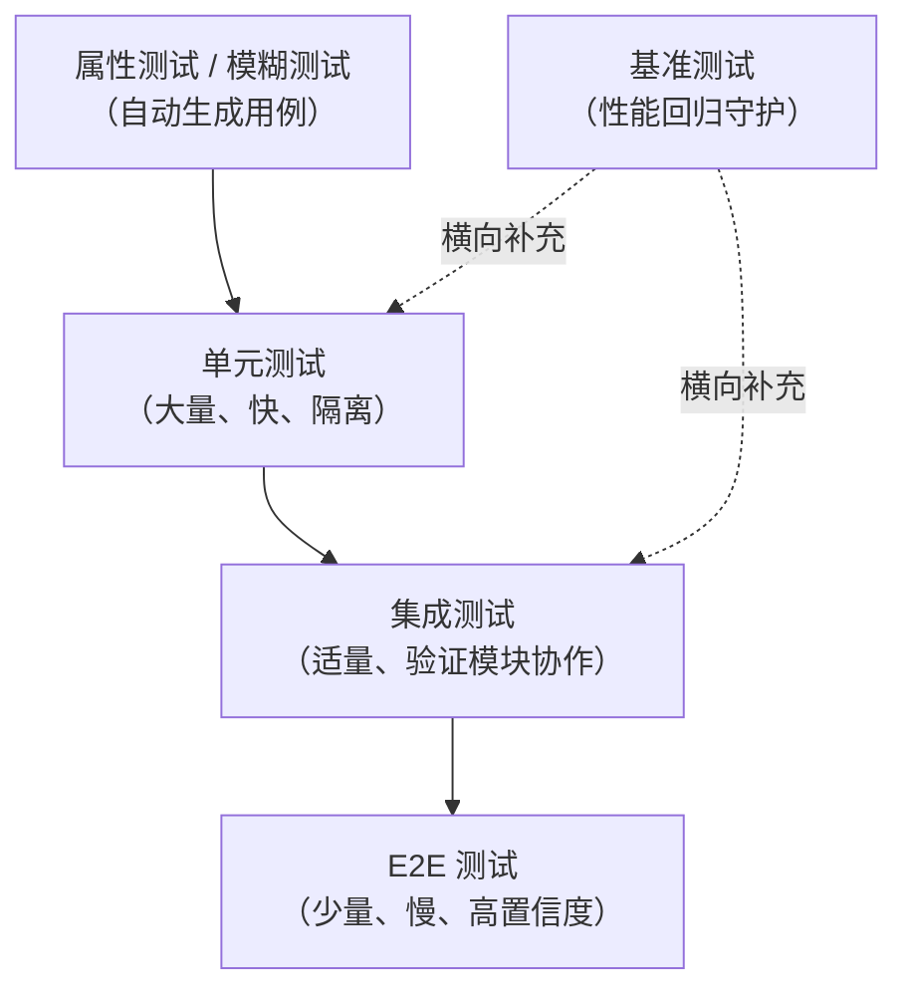

# 高级测试技术概述

在[第十一章](../11-testing/ch11-00-testing.md)中，我们学习了 Rust 测试的基础：单元测试、集成测试与文档测试。这些工具已经能够覆盖大多数日常场景，但在面对复杂系统时，我们需要更强大的武器库。

本章将介绍四个进阶测试维度：

- **属性测试**（*property-based testing*）：自动生成数千个测试输入，验证程序的不变性质
- **模糊测试**（*fuzzing*）：用随机字节流轰炸程序，发现边界崩溃与安全漏洞
- **模拟**（*mocking*）：隔离外部依赖，让单元测试真正"单元化"
- **基准测试**（*benchmarking*）：精确测量代码性能，量化优化效果

## 测试金字塔

良好的测试策略遵循「测试金字塔」原则：底层数量多、运行快；顶层数量少、成本高。

## 章节导航

| 章节 | 主题 | 核心库 |
|------|------|--------|
| [属性测试](ch24-01-property-testing.md) | 描述性质，自动生成用例 | `proptest` |
| [基准测试](ch24-02-benchmarking.md) | 精确性能测量与回归检测 | `criterion` |
| [Mock 测试](ch24-03-mocking.md) | 隔离依赖，测试业务逻辑 | `mockall` |
| [模糊测试](ch24-04-fuzzing.md) | 用覆盖率引导的输入探索发现边界问题 | `cargo-fuzz` |

## 何时使用进阶测试

- 实现了**编解码、序列化**等具有对称性质的算法 → 属性测试
- 处理**不可信的外部输入**（文件、网络数据）→ 模糊测试
- 业务逻辑依赖**数据库、HTTP 客户端、时钟**等外部资源 → Mock 测试
- 对**热点路径**进行了重构或算法替换 → 基准测试确认无回归
