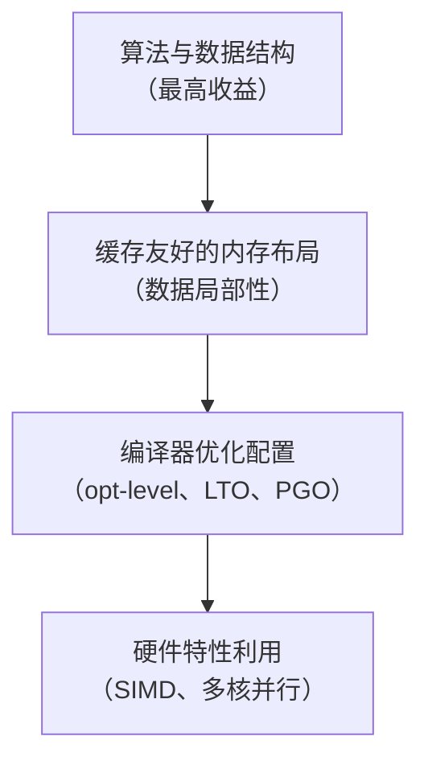

## 零成本抽象与性能保证

Rust 的核心设计哲学之一是**零成本抽象**（*zero-cost abstractions*）：高级语言特性（迭代器、泛型、trait 对象等）在编译后与手写的低级代码具有相同的运行时代价，不引入额外开销。

> *"What you don't use, you don't pay for. And further: What you do use, you couldn't hand code any better."*
> —— Bjarne Stroustrup（Rust 借鉴了这一理念）

具体体现在：

- **迭代器**：`iter().map().filter()` 编译后等价于手写 `for` 循环，LLVM 会自动向量化
- **泛型单态化**（*monomorphization*）：泛型函数为每个具体类型生成专用机器码，无虚函数开销
- **所有权系统**：编译期内存管理，运行时无垃圾回收停顿
- **内联**：`#[inline]` 和链接时优化（LTO）消除函数调用开销

## 性能调优的四个层次



### 第一层：算法与数据结构

优化算法复杂度永远是第一步。将 `O(n²)` 改为 `O(n log n)` 带来的收益远超任何底层调整。

Rust 标准库提供高性能容器：

- `HashMap`：使用 Swiss Table 算法（Rust 1.36+），性能卓越
- `BTreeMap`：缓存友好的 B 树，范围查询场景优于哈希表
- `Vec<T>`：连续内存，CPU 预取友好
- `VecDeque<T>`：双端队列，头部插入 `O(1)`

### 第二层：缓存友好的内存布局

现代 CPU 的内存访问延迟差异巨大：

| 存储层级 | 访问延迟（近似） |
|---|---|
| L1 缓存 | ~1 ns |
| L2 缓存 | ~4 ns |
| L3 缓存 | ~10 ns |
| 主内存（RAM） | ~60–100 ns |

缓存行（*cache line*）通常为 64 字节。结构体字段排列、热/冷数据分离都会显著影响缓存命中率。详见 [内存布局优化](ch26-01-memory-layout.md)。

### 第三层：编译器优化配置

Cargo 的 `[profile.release]` 提供多种旋钮：

```toml
[profile.release]
opt-level = 3
lto = "thin"
codegen-units = 1
panic = "abort"
```

详见 [性能分析工具](ch26-02-profiling.md) 中的编译配置章节。

### 第四层：硬件特性利用

- **SIMD**：通过 `std::arch` 或 `packed_simd`/`wide` crate 手写向量指令
- **并行化**：使用 `rayon` crate 将迭代器并行化，一行代码改 `.iter()` 为 `.par_iter()`
- **异步 I/O**：Tokio 或 async-std 避免线程阻塞，提升 I/O 密集型程序吞吐量

## 性能调优工作流


**黄金法则：先测量，再优化。** 凭直觉优化往往事倍功半，甚至适得其反。

### 推荐工具链

| 工具 | 用途 |
|---|---|
| `criterion` | 微基准测试，统计显著性检验 |
| `flamegraph` | 火焰图，可视化 CPU 热点 |
| `cargo-pgo` | Profile-Guided Optimization |
| `heaptrack` / `dhat` | 堆内存分配分析 |
| `valgrind --tool=callgrind` | 指令级性能分析 |
| `perf` (Linux) | 系统级性能计数器 |

## 常见性能坑

1. **过早优化**：在没有测量数据前，不要猜测瓶颈所在
2. **忽视分配**：频繁的小内存分配比计算更伤性能，考虑 `Arena` 分配器或对象池
3. **错误的 clone**：不必要的 `clone()` 会引入复制开销，优先使用引用
4. **调试模式测试**：务必在 `--release` 模式下测量性能，调试模式禁用了几乎所有优化
5. **单线程瓶颈**：I/O 密集型程序用异步，CPU 密集型用 `rayon` 并行迭代
