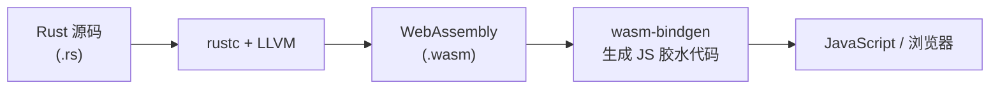

## 什么是 WebAssembly

WebAssembly（简称 *WASM*）是一种为浏览器和服务器环境设计的低级字节码格式。它具备以下特性：

- **接近原生性能**：比 JavaScript 快 10–100 倍（计算密集型任务）
- **安全沙箱**：在严格隔离的内存环境中运行，无法直接访问宿主系统
- **跨平台**：同一 `.wasm` 文件可在浏览器、Node.js、边缘计算、服务端运行时中运行
- **多语言支持**：Rust、C/C++、Go、AssemblyScript 等均可编译到 WASM

**Rust → WASM 编译路径**：



**典型应用场景**：

- 前端高性能计算（图像处理、视频编解码、加密算法）
- 游戏引擎（Bevy 实验性 WASM 支持）
- 边缘计算（Cloudflare Workers、Fastly Compute@Edge）
- 插件系统（Zed 编辑器、Extism 框架）

## 工具链安装

```bash
# 添加 WASM 编译目标
rustup target add wasm32-unknown-unknown

# 安装 wasm-pack（推荐，自动处理 JS 胶水代码生成和打包）
cargo install wasm-pack

# 可选：安装 wasm-bindgen-cli（底层工具）
cargo install wasm-bindgen-cli
```

## 最简单的 WASM 库

### 项目配置

```toml
# Cargo.toml
[package]
name = "my-wasm-lib"
version = "0.1.0"
edition = "2021"

[lib]
# cdylib：生成动态链接库（WASM 格式）
crate-type = ["cdylib"]

[dependencies]
wasm-bindgen = "0.2"
```

### 编写 Rust 代码

```rust
// src/lib.rs
use wasm_bindgen::prelude::*;

/// 向 JavaScript 暴露的函数：生成问候语
#[wasm_bindgen]
pub fn greet(name: &str) -> String {
    format!("你好，{name}！来自 Rust + WASM")
}

/// 递归计算斐波那契数（演示计算密集型任务）
#[wasm_bindgen]
pub fn fibonacci(n: u32) -> u32 {
    match n {
        0 => 0,
        1 => 1,
        n => fibonacci(n - 1) + fibonacci(n - 2),
    }
}

/// 暴露结构体给 JavaScript
#[wasm_bindgen]
pub struct Point {
    pub x: f64,
    pub y: f64,
}

#[wasm_bindgen]
impl Point {
    #[wasm_bindgen(constructor)]
    pub fn new(x: f64, y: f64) -> Self {
        Self { x, y }
    }

    pub fn distance_to(&self, other: &Point) -> f64 {
        let dx = self.x - other.x;
        let dy = self.y - other.y;
        (dx * dx + dy * dy).sqrt()
    }
}
```

### 构建与使用

```bash
# 构建为 Web 目标（生成 ES Module）
wasm-pack build --target web

# 构建为 Node.js 目标
wasm-pack build --target nodejs

# 构建为 bundler 目标（Webpack、Vite）
wasm-pack build --target bundler
```

构建产物在 `pkg/` 目录，包含：

- `my_wasm_lib_bg.wasm`：编译后的 WASM 二进制
- `my_wasm_lib.js`：JavaScript 胶水代码
- `my_wasm_lib.d.ts`：TypeScript 类型声明

在 JavaScript 中使用：

```javascript
// ES Module 方式（--target web）
import init, { greet, fibonacci, Point } from './pkg/my_wasm_lib.js';

async function run() {
    // 必须先初始化（加载并编译 .wasm 文件）
    await init();

    console.log(greet("世界"));           // "你好，世界！来自 Rust + WASM"
    console.log(fibonacci(10));           // 55

    const p1 = new Point(0, 0);
    const p2 = new Point(3, 4);
    console.log(p1.distance_to(p2));     // 5.0
}

run();
```

## 与 JavaScript 交互

### 操作 DOM（`web-sys`）

`web-sys` 提供了完整的 Web API 绑定，每个 API 通过 Cargo feature 单独启用以控制编译体积：

```toml
[dependencies]
wasm-bindgen = "0.2"
web-sys = { version = "0.3", features = [
    "Window",
    "Document",
    "Element",
    "HtmlElement",
    "console",
] }
```

```rust
use wasm_bindgen::prelude::*;
use web_sys::window;

#[wasm_bindgen]
pub fn update_title(title: &str) {
    let window = window().expect("无法获取全局 window 对象");
    let document = window.document().expect("无法获取 document");
    document.set_title(title);
}

#[wasm_bindgen]
pub fn append_paragraph(text: &str) {
    let window = window().unwrap();
    let document = window.document().unwrap();
    let body = document.body().unwrap();

    let p = document.create_element("p").unwrap();
    p.set_text_content(Some(text));
    body.append_child(&p).unwrap();
}
```

### 调用 JavaScript 函数（`js-sys`）

```toml
[dependencies]
wasm-bindgen = "0.2"
js-sys = "0.3"
```

```rust
use wasm_bindgen::prelude::*;
use js_sys::Date;

#[wasm_bindgen]
pub fn current_timestamp() -> f64 {
    Date::now()  // 调用 JavaScript 的 Date.now()
}
```

### 从 JavaScript 传入回调函数

```rust
use wasm_bindgen::prelude::*;

#[wasm_bindgen]
pub fn process_with_callback(data: &[u8], callback: &js_sys::Function) {
    let result = data.iter().map(|&b| b * 2).collect::<Vec<u8>>();
    let js_array = js_sys::Uint8Array::from(result.as_slice());
    callback.call1(&JsValue::NULL, &js_array).unwrap();
}
```

## WASM 体积优化

WASM 二进制体积直接影响首次加载时间，务必重视。

```toml
# Cargo.toml
[profile.release]
opt-level = "z"    # 优化体积（而非速度）
lto = true
codegen-units = 1
panic = "abort"    # 移除 panic 展开代码，减少体积
```

```bash
# 安装体积分析工具
cargo install twiggy

# 分析哪些函数占用了最多体积
twiggy top target/wasm32-unknown-unknown/release/my_wasm_lib.wasm

# 使用 wasm-opt 进一步压缩（来自 binaryen 工具集）
# wasm-pack build 默认已调用 wasm-opt
wasm-opt -Oz -o output.wasm input.wasm
```

优化效果对比（典型项目）：

| 配置 | 大小（近似） |
|---|---|
| `opt-level = 0`（调试） | ~2 MB |
| `opt-level = 3`（速度优化） | ~300 KB |
| `opt-level = "z"` + wasm-opt | ~80 KB |
| + wasm-pack gzip | ~30 KB |

## WASM 组件模型与 WIT

WASM 组件模型（*Component Model*）是下一代 WASM 互操作标准，允许不同语言编写的 WASM 模块直接互调，无需手写胶水代码。

**核心概念**：

- **WIT**（WASM Interface Types）：跨语言接口定义语言，类似 IDL
- **`wit-bindgen`**：从 `.wit` 文件自动生成 Rust 绑定
- **Wasmtime**：支持组件模型的 WASM 运行时

```wit
// my-interface.wit
package example:greet;

interface greeter {
    greet: func(name: string) -> string;
}

world my-world {
    export greeter;
}
```

```bash
# 安装 wit-bindgen
cargo install wit-bindgen-cli

# 生成 Rust 绑定
wit-bindgen rust my-interface.wit
```

组件模型目前处于快速发展阶段，适合关注 WASM 服务端（WASI）和插件系统场景。

## 调试技巧

```rust
// 在 WASM 中使用 console.log 输出调试信息
use wasm_bindgen::prelude::*;

#[wasm_bindgen]
extern "C" {
    #[wasm_bindgen(js_namespace = console)]
    fn log(s: &str);
}

macro_rules! console_log {
    ($($t:tt)*) => (log(&format_args!($($t)*).to_string()))
}

#[wasm_bindgen]
pub fn debug_example() {
    console_log!("Rust WASM 调试信息：x = {}", 42);
}
```

```bash
# 开启 WASM 调试符号（允许在浏览器 DevTools 中看到 Rust 函数名）
RUSTFLAGS="-C debuginfo=2" wasm-pack build --dev
```
